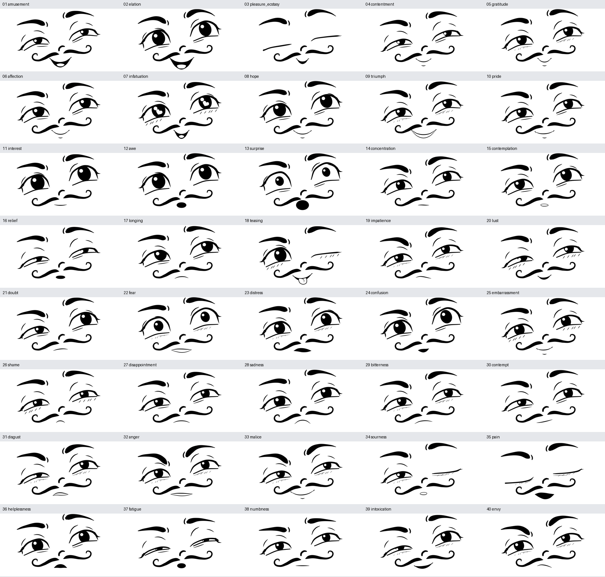

# Cartoon Face Generator · 101 Keypoints

Dieses Projekt erzeugt ein wiedererkennbares Cartoon-Gesicht vollständig als **parametrisches SVG**. Augen, Brauen, Pupillen, Mund und die geschwungenen Wangenlinien lassen sich unabhängig verformen. Alle Ausdrücke behalten dieselben **101 semantischen Keypoints**. Eine gespeicherte Pose enthält die vollständige Geometrie und lässt sich ohne Referenzbild erneut rendern.

Vorhanden sind **40 EmoNet-Face-Ausdrücke**, **60 zusätzliche soziale und verspielte Ausdrücke**, ein Browser-Editor, Werkzeuge für synthetische Trainingsdaten, ein trainierter Cartoon-Keypoint-Detector und eine **CPU-Webcam- und Audio-Demo**.

Die aktuelle Windows-Demo **2.3.2** überträgt Webcam-Mimik auf das Rig und animiert ausgewählte MP3-/WAV-Dateien anhand von Wortzeitstempeln, LAION-Ears-Emotionswerten und Sprechstil. Dazu kommen weiche Übergänge, organische Sprechbewegungen und optionaler Blickkontakt mit Kopfbewegung per Webcam. Negative Ausdrücke berücksichtigen Ärger und Stimmspannung gemeinsam. [Start, Modellinstallation und Grenzen](webcam_mapper/README.md) sind separat beschrieben; die großen Audiomodelle werden nicht mit Git verteilt.

## Was möchtest du machen?

| Ich möchte … | Hier anfangen |
|---|---|
| die Bilder ansehen | [Vorschauen und Downloads](docs/previews.md) |
| den Generator oder Editor starten | [Schritt-für-Schritt-Einstieg](docs/getting_started.md) |
| wissen, wo welche Dateien liegen | [Repository-Wegweiser](docs/repository_map.md) |
| verstehen, was die 101 Punkte bedeuten | [vollständiger Keypoint-Katalog](docs/topology.md) und [nummerierte Abbildung](docs/landmarks/overview.png) |
| JSON-Posen lesen, verändern oder speichern | [Datenformat und Einheiten](docs/data_format.md) |
| Ausdrücke erzeugen, variieren oder mischen | [CLI-Beispiele](docs/cli.md), [40 Emotionen](docs/emotions.md), [60 soziale Ausdrücke](docs/social_expressions.md) |
| mit meiner Webcam den Avatar steuern | [Laptop-Anleitung](webcam_mapper/README.md) |
| eine MP3-/WAV-Datei mit passender Mimik abspielen | [Audio-Bühne und Einrichtung](webcam_mapper/README.md#audio-bühne) |
| eigene Trainingsdaten erzeugen | [Datensatz und Augmentationen](docs/dataset.md) |
| das Keypoint-Modell benutzen oder trainieren | [Training und Inferenz](training/README.md), [gemessene Ergebnisse](docs/detector_results.md) |
| sprechende Cartoon-Videos mit LTX 2.5 erzeugen | [Videotests, Skripte und Zeitmessungen](video_experiments/README.md) |
| die Implementierung erweitern | [Architektur](docs/architecture.md) und [Entwicklungsanleitung](CONTRIBUTING.md) |

Alle Anleitungen sind über den [Dokumentationsindex](docs/README.md) erreichbar. Englischer Kurzüberblick: [English overview](docs/overview_en.md).

## Ausdrücke ansehen

### 40 EmoNet-Face-Archetypen



[Alle 40 SVG-/PNG-/JSON-Dateien](output/emonet/archetypes) · [Definitionen und Namen](docs/emotions.md)

### 60 soziale und cartoonhafte Archetypen


[Alle 60 SVG-/PNG-/JSON-Dateien](output/social/archetypes) · [Definitionen und Namen](docs/social_expressions.md)

Jeder Archetyp liegt als **SVG, PNG und vollständiges Pose-JSON** vor. Die zusätzlichen sozialen Ausdrücke sind ein eigener, von uns entworfener Katalog. Die Emotionsnamen beschreiben beabsichtigte gestalterische Ziele; eine menschliche Erkennungsrate wurde bisher nicht gemessen.

## Schnellstart: Generator und Editor

Getestet mit **Python 3.12**. Alle folgenden Befehle werden im Repository-Hauptordner ausgeführt. Unter Debian/Ubuntu benötigt CairoSVG die Systembibliothek `libcairo2`; bei Bedarf zuerst `sudo apt install libcairo2` ausführen.

```bash
git clone https://github.com/christophschuhmann/cartoon-face-generator.git
cd cartoon-face-generator
python3.12 -m venv .venv
.venv/bin/python -m pip install -e .

# Eine gespeicherte Pose als SVG und PNG rendern.
.venv/bin/face render --pose poses/smile.json --output output/my_face.svg --png output/my_face.png

# Den lokalen Editor starten.
.venv/bin/face serve --port 8766
```

Im Browser **http://127.0.0.1:8766** öffnen. Die Galerien liegen unter `/emotions` und `/social`. Der Editor kann Punkte verschieben, IDs zeigen, Parameter ändern, eine Referenz überlagern und JSON/SVG/PNG exportieren. Für Installation mit `uv`, Windows, macOS und die Webcam siehe [Einstiegsanleitung](docs/getting_started.md).

Die bereitgestellte [HTTPS-Demo](https://owner-curves-cosmetics-taught.trycloudflare.com/) verwendet einen temporären Cloudflare-Tunnel. Die lokale Installation funktioniert unabhängig von diesem Tunnel.

## Ein Ausdruck, eine Variation, eine Mischung

```bash
# Ohne Seed: festgelegter Archetyp. Mit Seed: reproduzierbare Variation.
.venv/bin/face emotion --taxonomy emonet --name anger --output output/anger.svg
.venv/bin/face social --name knowing_wink --seed 42 --output output/wink.svg

# 0 = Ausdruck a; 1 = Ausdruck b. Auch katalogübergreifend möglich.
.venv/bin/face mix --a emonet:amusement --b social:knowing_wink --weight 0.5 --output output/mix.svg
```

Diese Befehle speichern jeweils `.svg`, `.png` und `.json` unter demselben Dateistamm. [Weitere Befehle](docs/cli.md) erklären Intensität, Variationen, Sequenzen, Rekonstruktion und Datensatzexport.

## Generator, Detector und Webcam: drei verschiedene Aufgaben

| Bestandteil | Eingabe | Ausgabe | Implementierung |
|---|---|---|---|
| **SVG-Generator** | vollständige Pose oder Ausdrucksrezept | SVG/PNG und Pose mit 101 Keypoints | [src/cartoon_face](src/cartoon_face) |
| **Cartoon-Detector** | Rasterbild eines Cartoon-Gesichts | 101 vorhergesagte Positionen und Sichtbarkeiten | [training](training) / PyTorch |
| **Webcam-Mapper** | menschliches Gesicht aus Kamera/Bild/Video | Steuerwerte → gemeinsame Cartoon-Pose → SVG | [webcam_mapper](webcam_mapper) / MediaPipe auf CPU |

Generator und Editor benutzen denselben Python-Renderer. Auch die Webcam-Demo ruft dieses Rig auf. Die Webcam benötigt den trainierten Cartoon-Detector nicht. [Die Architekturübersicht](docs/architecture.md) zeigt die Verbindungen.

## Wichtige Datenkonventionen

- Landmark-IDs bleiben **0–100**, unabhängig von Ausdruck und Sichtbarkeit.
- `left_*` bedeutet **links aus Sicht der Figur**, also rechts im Bild.
- Keypoints speichern normalisierte `[u,v]` mit Ursprung links oben. Das kanonische Geometriesystem ist **1450 × 750**; Rig-Längen verwenden kanonische Pixel.
- Ein Punkt bleibt auch bei `occluded` oder `absent` unter derselben ID gespeichert.
- Für exaktes Wieder-Rendering braucht man **Keypoints + Rig + Varianten + Geometriemodus**. Nur 101 Koordinaten reichen dafür nicht aus.
- Die Unteraugenlinien verwenden ein [gemeinsames kontinuierliches Übergangsmodell](docs/under_eye.md); feste Strich-Slots gehen weich von einer Kurve in kleine Falten über.

Eine echte vollständige Beispielpose: [poses/smile.json](poses/smile.json). Verbindliche Definitionen: [Topologieregister](src/cartoon_face/topology/face_topology.json) und [JSON-Schema](src/cartoon_face/topology/pose.schema.json).

## Was liegt im Checkout, was im Download?

| Inhalt | Wo? |
|---|---|
| Quellcode, Dokumentation, sechs Referenzposen und alle 100 Archetypen | direkt in diesem Repository |
| ein Beispiel je Ausdruck plus Kontaktbögen und Qualitätsberichte | [output](output); [Inhaltsverzeichnis](output/README.md) |
| alle 100 Archetypen **und 560 weitere Vorschauvarianten** | [expression_previews.zip](https://github.com/christophschuhmann/cartoon-face-generator/releases/download/v1.0.0/expression_previews.zip), etwa 90 MB |
| aktuelle Webcam-/Audio-Demo einschließlich geprüftem MediaPipe-Modell | [cartoon_webcam_mapper.zip](webcam_mapper/output/cartoon_webcam_mapper.zip), etwa 3,6 MB; große Audio-/Emotionsmodelle separat installieren |
| neuer robuster / normalpräziser Cartoon-Detector | [robust](https://github.com/christophschuhmann/cartoon-face-generator/releases/download/v1.1.0/cartoon_landmarks_robust.pt) / [normalpräzise](https://github.com/christophschuhmann/cartoon-face-generator/releases/download/v1.1.0/cartoon_landmarks_precise.pt), jeweils etwa 4,1 MB |
| historische Detector-Baseline | [cartoon_landmarks_best.pt](https://github.com/christophschuhmann/cartoon-face-generator/releases/download/v1.0.0/cartoon_landmarks_best.pt) |
| LTX-2.5-Videos mit Sprache, Eingaben und Zeitmessungen | [ltx25_examples.zip](https://github.com/christophschuhmann/cartoon-face-generator/releases/download/v1.1.0/ltx25_examples.zip), etwa 48 MB; [Galerie](https://owner-curves-cosmetics-taught.trycloudflare.com/refinement-assets/ltx25/index.html) |
| großer Datensatz mit 105.000 SVG-/JSON-Paaren und Trainingscache | separat erzeugen; **nicht im Git-Checkout und nicht im Vorschau-ZIP** |

Der vollständige Datensatz umfasst komprimiert **7,00 GB**, der Trainingscache weitere **0,834 GB**. Er enthält 1.000 Posen pro Ausdruck und 5.000 extreme Verformungen. [Befehle, Splits und Audit](docs/dataset.md) sind dokumentiert; [Manifeste](docs/artifacts/README.md) liegen im Repository.

## Gemessene Qualität und Grenzen

Die sechs Originalreferenzen wurden mit demselben Rig rekonstruiert. Der Mittelwert beträgt **IoU 0,910 / Dice 0,953**; [Vergleichsbilder](output/comparisons/all_references.png), [regionale Messwerte](output/evaluation.json) und [Rekonstruktionsbericht](docs/phase1_report.md) zeigen die Abweichungen.

Nach vier längeren Trainings erreicht der robuste Detector auf dem **unveränderten Testset** **0,330 Pixel normal / 10,291 Pixel bei extremen OOD-Verformungen**, jeweils bei 320 × 192. Die normalpräzise Variante erreicht **0,209 / 11,901 Pixel**. Die alte Baseline lag bei **0,231 / 15,620 Pixel**. Der robuste Checkpoint verbessert den Fehler auf den sechs Originalzeichnungen von **4,379 auf 1,700 Pixel**; synthetische Varianten dieser Rig-Pose-Familien sind nun im Training vertreten. Diese Zahlen betreffen Landmark-Positionen innerhalb dieser Cartoon-Identität, keine Emotionserkennung. [Vollständige Ergebnisse und Einschränkungen](docs/detector_results.md).

Die MediaPipe-Pipeline wurde auf CPU mit einem realen Human-Foto, einem daraus erstellten Testvideo und einer simulierten Browser-Kamera geprüft. Eine echte Laptop-Webcam stand hier nicht zur Verfügung. [Nachweise und praktische Grenzen](webcam_mapper/README.md).

## Entwicklung und Lizenz

```bash
.venv/bin/python -m pip install -e '.[test]'
.venv/bin/python -m pytest -q
```

Torch-Tests, Browserprüfung und Änderungen am Rig sind in [CONTRIBUTING.md](CONTRIBUTING.md) beschrieben. Ein GitHub-Actions-Workflow liegt als optionales [Template](tools/github_ci_template.yml) bei; automatische Actions sind derzeit nicht aktiviert.

Der Projektcode steht unter [MIT](LICENSE). Die Kernbibliotheken sind Open Source. Angaben zum externen MediaPipe-Modell und zum verwendeten Testfoto stehen in [webcam_mapper/THIRD_PARTY.md](webcam_mapper/THIRD_PARTY.md). Die separaten [LTX-Videotests](video_experiments/README.md) verwenden externen Code und Gewichte unter der LTX-Community-Lizenz. Ein eigenes generatives Motion-Modell ist nicht implementiert.
