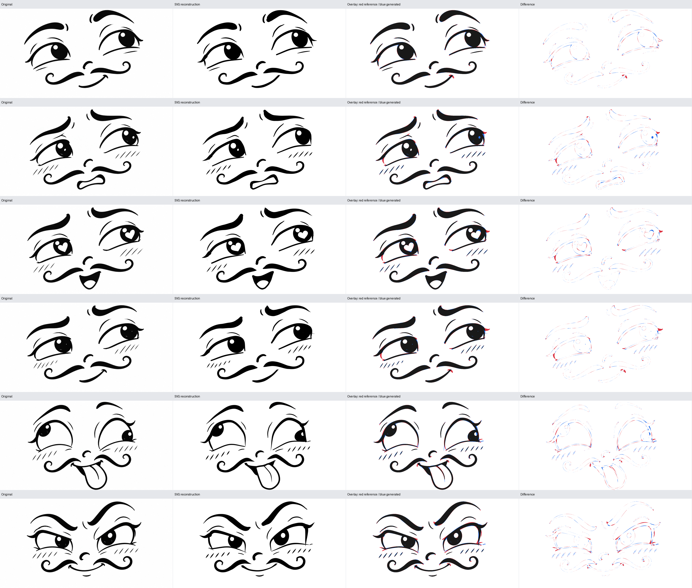
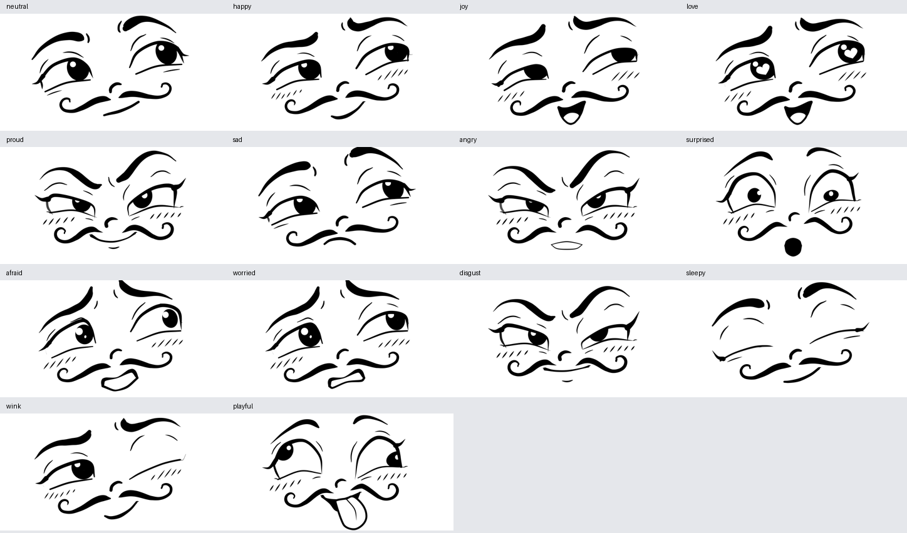

# Parametrisches Cartoon Face Rig

Ein gemeinsamer Python/SVG-Renderer mit **101 festen semantischen Landmark-IDs**, sechs gefitteten Referenzposen, automatischer Rekonstruktion und lokalem Keypoint-Editor. Die prozedurale Schicht erzeugt **40 offizielle EmoNet-Face-Kategorien und 60 zusätzliche soziale/cartoonhafte Ausdrücke** mit Variationen und Mischungen. Ein Datensatz mit **105.000 SVG-/Pose-Paaren**, passende Rasteraugmentationen, ein trainierter 101-Punkt-Detector und eine separate CPU-MediaPipe-Webcam-Demo ergänzen das Rig. Die Originale liegen unter `images/` (kleingeschrieben).

Für Außenstehende: [Bedeutung aller 101 Punkte](docs/topology.md), [Datenformat, Einheiten und nummerierte Abbildungen](docs/data_format.md), [40 Emotionsrezepte und prozedurale Generierung](docs/emotions.md), [tatsächliche Prüfungen und Grenzen](docs/emotion_validation.md).

Neu: [60 soziale Ausdrücke](docs/social_expressions.md), [geschmeidige Unteraugen-Morphs](docs/under_eye.md), [Datensatz / Augmentationen / Labels](docs/dataset.md), [Detector-Training](training/README.md), [gemessene Ergebnisse](docs/detector_results.md) und [Webcam-Demo für den Laptop](webcam_mapper/README.md). EmoNet-Rezept 1.2 und Sozial-Rezept 1.1 verwenden dasselbe kontinuierliche Unteraugensystem. Veröffentlichte Kategorien, selbst entworfene Situationen und gemessene Landmark-Ergebnisse werden getrennt ausgewiesen.

Rezeptversion **1.1** verfeinert den bestehenden Ausdrucksstil: glattere Strichkappen, ovale Mundformen, weichere Lichtreflexe und subtil wärmere negative Emotionen. [Vorher/Nachher](output/refinement/comparisons/selected_emotions.png) und [Änderungsbericht](docs/emotion_refinement.md) zeigen die tatsächlichen Renderings. Die 101 IDs bleiben gleich; alte gespeicherte Posen werden weiterhin exakt gerendert.

Die Ausgaben enthalten editierbare gefüllte Bézier-Konturen und Ellipsen. Es werden keine Referenzpfade, eingebetteten Rasterbilder oder generativ erzeugten Vergleichsbilder verwendet. Die umfangreicheren Konturen werden aus wenigen semantischen Ankern, Tangenten und Breitenprofilen abgeleitet.



## Installation und schneller Einstieg

Python 3.12 und die Cairo-Systembibliothek werden benötigt. Auf Debian/Ubuntu kann letztere mit `sudo apt install libcairo2` installiert werden. In dieser Arbeitsumgebung sind Umgebung und Ausgaben bereits vorhanden.

```bash
uv sync --locked --extra test
.venv/bin/face render --pose poses/smile.json --output output/face.svg --png output/face.png
.venv/bin/face serve --port 8766
```

Editor: **http://127.0.0.1:8766**; 40-Emotionsgalerie: **http://127.0.0.1:8766/emotions**; 60 soziale Ausdrücke: **http://127.0.0.1:8766/social**. Alle verwenden über Flask denselben Python-Renderer wie die CLI. Im Browser existiert keine zweite Gesichtsgeometrie.

Ohne uv: `python3 -m venv .venv`, anschließend `.venv/bin/pip install -e '.[test]'`. `uv.lock` hält die tatsächlich aufgelösten Paketversionen fest; `.python-version` legt Python 3.12 fest.

## Die sechs gefitteten Posen

| Pose | Ausdruck | Details |
|---|---|---|
| `smile` | freundliches asymmetrisches Lächeln | durchgehende Unteraugenlinien |
| `tense` | unsicher / angespannt | enger weißer Mundinnenraum, Schraffuren, doppelte Reflexe |
| `love` | verliebt / begeistert | weiße Herzreflexe, offener Mund, Innenzunge |
| `cheeky` | schelmisches Grinsen | Schraffuren, stärker abgesenkte Braue |
| `tongue` | verspielt | große Augen, langer Zungenumriss und Mittellinie |
| `skeptical` | skeptisch / selbstbewusst | schräge Lider, gegensinnige Brauen, Unterlippenakzent |

Die aktuelle vollständige Messtabelle und verbleibende Fehler stehen in [docs/phase1_report.md](docs/phase1_report.md). Maschinenlesbare Ergebnisse: [output/evaluation.json](output/evaluation.json).

## Ausführbare Workflows

Alle Befehle aus diesem Repository-Verzeichnis ausführen:

Die neuen 40-Kategorien-Workflows:

```bash
.venv/bin/face list_emotions
.venv/bin/face emotion --taxonomy emonet --name anger --seed 42 --variation 0.85 --output output/anger.svg
.venv/bin/face generate_emotions --variations 8 --seed 42
.venv/bin/face mix --a amusement --b teasing --weight 0.5 --output output/playful_mix.svg
.venv/bin/face validate_emotions --variations 8 --frames 32 --seed 42
# Nach tatsächlichen Bewertungen im Browser:
.venv/bin/face evaluate_reviews --input path/to/emotion_reviews.json --output output/emonet/review_results.json
```

`emotion` und `mix` speichern JSON/SVG/PNG gemeinsam. Ein Seed erzeugt eine Variation; ohne Seed wird der Archetyp geladen. `--intensity` interpoliert Richtung neutral. Ohne `--taxonomy emonet` verwendet `emotion` weiterhin die alten Ausdrücke. Beispiele und vollständige Definitionen stehen in [docs/emotions.md](docs/emotions.md).

Die bisherigen Rekonstruktions- und Rig-Workflows:

Die zusätzlichen sozialen und Datensatz-Workflows:

```bash
.venv/bin/face social --name knowing_wink --seed 42 --output output/wink.svg
.venv/bin/face generate_social --variations 4 --seed 42
OPENBLAS_NUM_THREADS=1 OMP_NUM_THREADS=1 .venv/bin/face build_dataset --per-expression 1000 --ood-count 5000 --workers 16
.venv/bin/face export_rasters --dataset datasets/cartoon_landmarks_v2 --limit 100 --width 512 --height 320 --output output/augmented
```

SVG/JSON werden komprimiert in TAR-Shards gespeichert; PNG/JPG und COCO-/JSONL-Labels entstehen bei Bedarf. Der gespeicherte finale SVG-Datensatz umfasst 7,00 GB, der komprimierte Trainingscache ungefähr 0,834 GB. Diese großen Artefakte gehören nicht zum Git-Checkout. Ein neuer Checkout erzeugt sie mit den oben dokumentierten Befehlen.

```bash
# Inventar, Analysebericht und Kontaktbogen
.venv/bin/face inspect_images

# Identischer Ausschnitt für alle Referenzen, ohne Glätten oder Entrauschen
.venv/bin/face preprocess

# Vollständiges hierarchisches Fitting; CPU, etwa einige Minuten
.venv/bin/face fit_references --max-nfev 170 --workers 3

# Rastervergleich und alle Original-/SVG-/PNG-/Overlay-/Differenzdateien
.venv/bin/face evaluate

# Eine gespeicherte Pose, bei Bedarf andere Auflösung
.venv/bin/face render --pose poses/tongue.json --output output/tongue.svg --png output/tongue.png
.venv/bin/face render --pose poses/smile.json --output output/large.svg --width 1536 --height 864

# Neue Emotion mit vollständigem JSON/SVG/PNG
.venv/bin/face emotion --name sad --output output/sad.svg
.venv/bin/face emotion --name surprised --intensity 0.8 --output output/surprised.svg

# Reproduzierbare korrelierte Variationen
.venv/bin/face generate_dataset --count 100 --seed 42

# Min. 30 Frames, JSON/SVG/PNG je Frame, GIF und Kontaktbogen
.venv/bin/face interpolate --from poses/smile.json --to poses/tongue.json --frames 60 --output output/interpolations/custom

# Tests A/B/C: sechs Rekonstruktionen, sieben Sequenzen à 32 Frames, 100 Samples
.venv/bin/face validate --frames 32 --count 100 --seed 42

# Verträge, echte Referenzqualität, Anatomie, Interpolation, Server und Seed
.venv/bin/python -m pytest -q

# Echter Browser-Test mit Downloads und Keypoint-Dragging
.venv/bin/python -m playwright install chromium
.venv/bin/python tools/test_editor.py
```

Auch `python tools/inspect_images.py`, `tools/fit_references.py`, `tools/render.py`, `tools/evaluate.py`, `tools/generate_dataset.py` und `tools/interpolate.py` sind CLI-Einstiegspunkte. Die Flags entsprechen den obigen Subcommands.

## Topologie und vollständiger Zustand

[face_topology.json](src/cartoon_face/topology/face_topology.json) enthält die **verbindliche ID-Reihenfolge, Namen, Regionen, Rollen, Bedeutungen und die Wirkung beim Verschieben**. Der lesbare vollständige Katalog steht in [docs/topology.md](docs/topology.md). [docs/data_format.md](docs/data_format.md) erklärt alle Einheiten, Sichtbarkeitszustände, Rig-Felder und geordnete Array-Exporte anhand sechs nummerierter SVG-/PNG-Abbildungen. Das Datenformat wird durch [pose.schema.json](src/cartoon_face/topology/pose.schema.json) und zusätzliche Wertebereichsprüfungen in `model.validate_pose` beschrieben.

- Links/rechts gelten aus Sicht der Figur: `left_*` liegt in der rechten Bildhälfte.
- Koordinaten `[u,v]` sind normalisiert, Ursprung links oben. Das kanonische System ist 1450 × 750 Pixel. Breiten und interne Größen verwenden kanonische Pixel.
- Jeder Landmark-Eintrag enthält `id`, `xy` und `state`: `visible`, `occluded` oder `absent`. Unsichtbare optionale Punkte behalten ihre Koordinate und ihre Bedeutung.
- Die Reihenfolge der JSON-Objektschlüssel ist unerheblich. Für spätere Tensoren nach dem zentralen Register bzw. nach `id` ordnen.
- `rig` enthält alle lokalen Breiten, Tangentenskalen, Pupillenradien, Reflexgrößen, Schraffurparameter und Deckkräfte. Diese sind **keine zusätzlichen ML-Landmarks**.
- `variants` beschreibt Unteraugenmodus, Reflexmodus und Mundinnenraum. `set_variant` setzt die zugehörigen Deckkräfte konsistent. Während eines Übergangs können mehrere Details gleichzeitig teiltransparent sein; diese Deckkräfte sind Bestandteil des vollständigen Zustands.
- `controls` dokumentiert zuletzt angewandte Steueraktionen. Der Renderer liest die resultierenden Keypoints und Rig-Werte; er wendet diese Aktionen beim erneuten Laden nicht ein zweites Mal an.
- Gleiche JSON-Geometrie ergibt byteidentische SVG-Geometrie. Andere Ausgabeauflösungen ändern nur die Canvas-Transformation. `preserveAspectRatio="none"` garantiert `x=u*width`, `y=v*height`; unterschiedliche Seitenverhältnisse strecken die Darstellung entsprechend.

Ein vollständiges Beispiel ist [poses/smile.json](poses/smile.json). Ein neu erzeugtes neutrales Master-SVG liegt unter [output/emotions/neutral.svg](output/emotions/neutral.svg).

## Geometrie und Kontrolle

Brauen und Wangenlinien sind **gefüllte Bänder mit positiver lokaler Breite**. Eine Hermite-Mittellinie läuft durch die semantischen Anker; ihre internen Tangenten und ein PCHIP-Breitenprofil erzeugen die beiden Konturgrenzen und runde bzw. zulaufende Enden. Jedes Wangenband besitzt acht Anker: innere Spitze, Schulter, Schwung, Bauch, äußerer Wendepunkt, Spiralscheitel, innere Spirale und Endspitze. Damit lassen sich Breite, Krümmung, Spiralrichtung und Asymmetrie getrennt verändern.

Jedes Auge besitzt fünf Oberlid- und drei Unterlidanker, einen Seitenabschluss, eine äußere Wimper und getrennte Pupillen-/Reflexanker. Ober- und Unterlid werden unabhängig verformt. Die Pupille wird durch die tatsächliche Augenöffnung beschnitten; beim Lidschluss bleibt die Tinte schwarz. Die Brauen besitzen jeweils fünf Anker mit variabler Dicke.

Die fünf oberen und drei unteren Mundanker bilden einen gemeinsamen Öffnungsraum. Mundwinkelakzente, eine Zunge mit sechs Konturankern und ihre Mittellinie sind feste optionale Komponenten. Die drei unteren Mundanker ergänzen die beiden oberen Mundwinkel. Der Renderer erkennt keine Referenzdateinamen und enthält keine bildspezifischen Pfadvarianten.

Unteraugenmodi: `none | continuous | hatching | mixed`. Schraffuren werden aus zwei semantischen Zonenankern erzeugt. Acht feste interne Slots kontrollieren Anzahl, Länge, Breite, Neigung und Abweichungen; bei gebrochener Anzahl erscheinen zusätzliche Slots weich. Kein Schraffurstrich erhält wechselnde Landmark-IDs.

## Ausdrucksraum und Editor

Alle 40 EmoNet-Archetypen:


Für jede Kategorie gibt es ein eigenes kompaktes Mimikrezept mit korrelierten Variationen. [catalog.json](src/cartoon_face/emotions/catalog.json) enthält offizielle Labels und unsere eigenen Cartoon-Hinweise; [emotion_library.py](src/cartoon_face/emotion_library.py) setzt sie in das bestehende Rig um. Seed, Intensität, Zufalls-Latents, 40 Steuergewichte und der vollständige aufgelöste Zustand werden gespeichert. Mischungen behalten feste Landmark-IDs und kennzeichnen ihre beiden beabsichtigten Anteile.

Geprüft sind 40 Archetypen und 320 Variationen (Seed 42), die Geometrie aller 780 Paare bei drei Zwischengewichten und zwölf gerenderte Sequenzen à 32 Frames. Die Bilder wurden anhand realer Kontaktbögen visuell verbessert. Der aktuelle Nachweis steht in [docs/emotion_validation.md](docs/emotion_validation.md).

**Die 40 Ziel-Labels sind Gestaltungsabsichten.** Besonders Dankbarkeit/Zuneigung, Stolz/Triumph und verwandte soziale Kategorien bleiben im statischen Gesicht mehrdeutig. Es gibt bisher keine gemessene menschliche Erkennungsgenauigkeit. Die Galerie kann Zielnamen ausblenden und Bewertungen exportieren; `evaluate_reviews` berechnet daraus echte Übereinstimmung und Konfusionsmatrix. Automatische Browser-Testexporte zählen nicht als menschliche Evidenz.

Bisherige zusätzliche Ausdrücke: `neutral`, `happy`, `joy`, `love`, `proud`, `sad`, `angry`, `surprised`, `afraid`, `worried`, `disgust`, `sleepy`, `wink`, `playful`.



Der Editor kann Referenzen und Emotionen laden, Seed-Variationen erzeugen und zwei der 40 Kategorien mit einem Anteil-Slider mischen. Er zeigt Punkte und IDs, erklärt jeden Punkt im Tooltip, erlaubt Anker-Dragging und kontrolliert Blickrichtung, Augenöffnung, Zusammenkneifen, Brauenhöhe/-neigung, Mund und Wangenlinien per Slider. Er kann Reflex- und Unteraugenmodi wechseln, optionale Akzentlinien ein-/ausschalten, die Referenz halbtransparent überlagern, JSON importieren und JSON/SVG/PNG exportieren. Reset lädt die gewählte Referenzpose neu. Slider werden relativ zur geladenen Basis angewandt; neutrale Multiplikatoren sind 1, neutrale Veränderungen 0.

Interpolation bewegt alle Anker kontinuierlich und erhält positive Breiten und begrenzte Tangenten. Optionale Zungen-/Mundunterkonturen werden erst nahe ihrer sinnvollen Zielgeometrie eingeblendet. Schwarze/weiße Mundinnenräume wechseln bei kurz auf null abgesenkter Deckkraft. Zwischenframes können durch das bewusste Ein-/Ausblenden graue Linien enthalten; die Endposen behalten die Schwarz-Weiß-Identität.

Synthetische Beispiele wählen Emotionen geschichtet und variieren anschließend korreliert Blick, Aktivierung, Asymmetrie, Öffnung, Mundbogen und Wangenkurven. Sie verwenden keine unabhängigen gleichverteilten Zufallswerte für alle Anker.

## Rekonstruktionsstrategie und Grenzen

Die sechs vorhandenen Referenzen werden mit **sparsamen semantischen Startannotationen** initialisiert. Das ist kein bereits trainierter Landmark-Detector für unbekannte Illustrationen. Das anschließende Fitting ist automatisch:

1. identische globale Vorverarbeitung;
2. komponentenweise beidseitige Kontur-Least-Squares für Brauen, Wangen, Nase und Akzente;
3. regionale Raster-Least-Squares für verbundene Augenformen einschließlich Pupillen, Reflexen und Herzen;
4. parametrische Schraffurzonen aus kurzen zusammenhängenden Strichen;
5. Mund-/Zungen-Fitting;
6. finale lokale Rasterverfeinerung der übrigen Bänder.

Alle Optimierungen verwenden begrenzte, semantisch gruppierte Parameter. Anker-/Breiten-/Tangentenregularisierung vermeidet freie Kontur-Overfits. Die finale Rasterverfeinerung verwendet denselben CairoSVG-Renderer und nimmt eine Änderung nur an, wenn der lokale Dice-Wert erhalten bleibt bzw. steigt. Rasterkonturen werden ausschließlich als temporäre Beobachtungen verwendet.

Die Auswertung enthält Foreground-IoU, Dice, symmetrischen Konturabstand, 95%-Konturdistanz und SSIM sowie feste Regionen für beide Augen, beide Brauen, Wangen, Nase und Mund. Maskenschwelle: Grau<128. SSIM wird wegen des großen weißen Hintergrunds und der feinen Referenztextur nicht allein als Qualitätsmaß verwendet.

Verbleibende Grenzen sind feine gegabelte Akzentstriche, einzelne Wimpernansätze, kleine Pupillenkratzreflexe und die genaue Zungen-/Mundkontur. Pupillen-/Reflexzentren werden gegen die tatsächliche Öffnungs-/Pupillengeometrie geprüft. Die übrige Komponentensichtbarkeit ist keine pixelgenaue Occlusion-Segmentierung. Freies Ziehen extremer Anker kann absichtlich unplausible Formen erzeugen; die getesteten Samples stammen aus eingeschränkten gültigen Expressionsbereichen. Weitere Referenzen brauchen zunächst passende semantische Initialisierungen und dokumentierte Varianten.

## Repository

```text
images/                         unveränderte Originale
src/cartoon_face/
  topology/                     ID-Register und Pose-JSON-Schema
  model.py                      Serialisierung und Validierung
  geometry.py                   interne Bézier-/Bandgeometrie
  components/                   Augen, Brauen, Wangen, Mund, Nase, Details
  renderer.py                   gemeinsamer SVG- und CairoSVG-Renderer
  reference.py, fitting.py       Bestandsaufnahme, Vorverarbeitung, Optimierung
  evaluation.py                 Metriken, Overlays, Differenzen
  expressions.py, animation.py   semantische Kontrolle und Interpolation
  emotions/, emotion_library.py 40-Kategorien-Katalog und korrelierte Rezepte
  emotion_validation.py         Klassen-/Variations-/Mischungsprüfungen
  emotion_reviews.py            echte Galerie-Urteile auswerten
  dataset.py, validation.py      Phase-1-Samples und A/B/C-Nachweise
  cli.py, server.py              CLI und lokale Browser-API
viewer/                         HTML/CSS/JS-Editor
docs/                           101-Punkte-Katalog, Datenformat, Emotionen, Berichte
poses/                          sechs vollständige Parametersätze
output/
  references/                   Arbeitskopien und affine Vorverarbeitung
  reconstructions/              Original, SVG, PNG, JSON, Metriken pro Pose
  comparisons/                  Overlay, Differenz, Kontaktbögen
  interpolations/               sieben Sequenzen, je 32 SVG/PNG/JSON-Frames
  synthetic_samples/            100 zusätzliche Zustände und Manifest
  emotions/                     14 Beispiele und neutrales Master-SVG
  emonet/                       40 Archetypen, 320 Variationen, 12 Sequenzen
  fitting/, editor/, analysis/   Optimierungsprotokolle und Prüfartefakte
```

Die Implementierung steht unter MIT. Die Kernbibliotheken sind Python, NumPy, SciPy, OpenCV, Pillow, scikit-image, CairoSVG und Flask. Das zusätzliche Detector-Training nutzt PyTorch; die unabhängige Webcam-Pipeline nutzt MediaPipe/TFLite auf CPU. Ein generatives Motion-Modell ist nicht implementiert. Emotionen sind beabsichtigte gestalterische Ziele; eine menschliche 100-Klassen-Erkennungsrate wird nicht behauptet.
