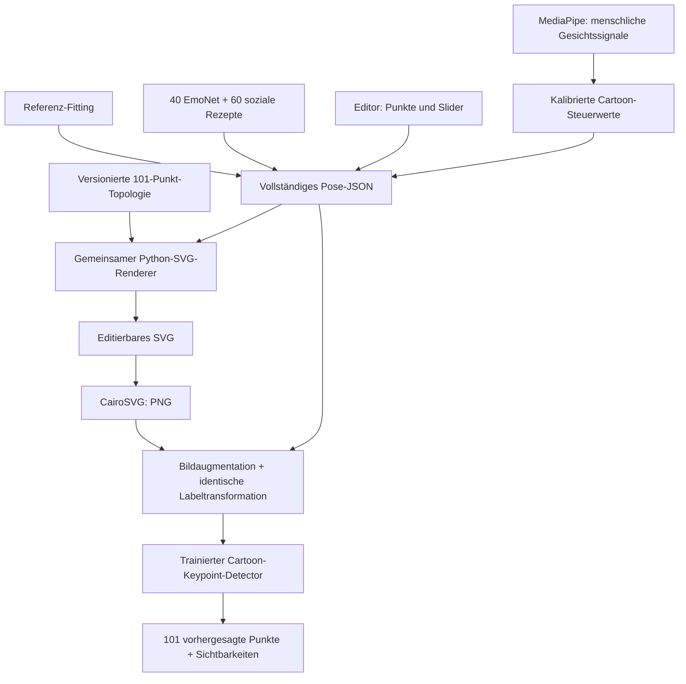

# Wie das System zusammenarbeitet

[Dokumentationsindex](README.md) · [Dateiübersicht](repository_map.md) · [Datenformat](data_format.md)

Das gemeinsame Modell ist die vollständige **Pose**. Sie verbindet semantische Keypoints, interne Formparameter, Stil und Sichtbarkeit. Der Renderer erzeugt daraus SVG-Geometrie. Ausdrucksrezepte, Editor und Webcam ändern dieses Modell; sie enthalten keine eigene alternative Zeichnung des Gesichts.

## Semantische Punkte und interne Geometrie

Ein Keypoint bezeichnet eine feste Rolle: etwa einen Augenwinkel, Brauenscheitel oder die Spitze einer Wangenlinie. Die Liste steht zentral im [Topologieregister](../src/cartoon_face/topology/face_topology.json). Ein Punkt bezeichnet in jeder Pose denselben Teil des Gesichts.

Bézier-Handles, Bandränder, lokale Strichbreiten und Schraffur-Slots sind dagegen **interne Rendergeometrie**. Sie werden aus den Ankern und `rig`-Werten abgeleitet. Sie vergrößern nicht die 101-Punkte-ML-Topologie. Dadurch kann eine detaillierte Kurve mit relativ wenigen interpretierbaren Ankern gesteuert werden.

Brauen, Lider und Wangenlinien sind überwiegend gefüllte Konturen mit variabler Breite. Die Wangenlinie hat acht semantische Anker pro Seite, einschließlich eingerollter Endung. Augen besitzen unabhängige obere und untere Lidkurven. Pupillen und Reflexe werden gegen die tatsächliche Augenöffnung beschnitten.

Das neuere `smooth_v1`-Verfahren glättet die abgeleiteten Bandkonturen und Kappen; `mouth_rounding` erlaubt einen weichen O-Mund. Alte Referenzposen ohne diesen Geometriemodus behalten das ursprüngliche Rendering.

## Unteraugenlinien bleiben kontinuierlich

Das System `stroke_bank_v1` hält pro Seite acht feste interne Strich-Slots vor. Ein kontinuierlicher Wert `foldness` bewegt und dreht diese von Fragmenten einer gemeinsamen Unteraugenkurve zu kurzen parallelen Falten. Deckkräfte und Slotgewichte sind mitgespeichert. Die IDs der fünf semantischen Unteraugen-/Schraffurzonenanker pro Seite bleiben unverändert.

Renderer, Ausdrucksrezepte, großer Datensatz und Webcam verwenden dieselbe Geometrie. Die Rasteraugmentation übernimmt die dazugehörigen Labels. [Darstellung des Übergangs und Felder](under_eye.md).

## Was für exaktes Wieder-Rendering gespeichert werden muss

| Teil der Pose | Bedeutung |
|---|---|
| `schema_version`, `topology_id` | kompatibles Format und feste Identität des Registers |
| `canvas`, `coordinate_system` | Ausgabegröße und normalisierte Koordinaten |
| `keypoints` | alle 101 IDs, Positionen und Zustände |
| `rig` | lokale Breiten, Tangenten, Ellipsen, Strich-Slots, Deckkräfte |
| `geometry` | optionaler, verbindlicher Glättungs-/Unteraugenmodus |
| `variants`, `style` | Darstellungsvarianten und Schwarz-Weiß-Stil |
| `recipe`, `emotion`, `expression`, `provenance` | Herkunft, Seed und beabsichtigte Ziele; keine nachträglich ausgeführten Renderaktionen |

Ein kompletter Zustand wird über `model.load_pose` geladen, über `model.validate_pose` geprüft und über `renderer.render_svg` gerendert. Der gespeicherte Seed ist hilfreich für die Entstehungsgeschichte; der vollständig aufgelöste Zustand ist für exaktes Wiederherstellen maßgeblich.

## Generierung und Übergänge

Die 40 EmoNet-Rezepte und 60 sozialen Rezepte übersetzen kleine, lesbare Mimikprogramme in das gemeinsame Rig. Variationen werden korreliert erzeugt: Blick, Lider, Brauen und Mund bewegen sich zusammen. Charakteristische Hinweise wie ein Zwinkern bleiben innerhalb des betreffenden sozialen Rezepts geschützt.

`animation.interpolate_pose(a,b,t)` interpoliert die festen Keypoints und Rig-Werte. Optionale Formen wie die Zunge werden nahe ihrer passenden Zielgeometrie weich eingeblendet. Die beiden Ausdruckskataloge behalten getrennte Metadaten und Gewichtsvektoren. Diese Gewichte sind Gestaltungsanteile, keine Erkennungswahrscheinlichkeiten.

## Synthetische Daten und Detector

Die großen Shards speichern jeweils **SVG und vollständige Pose**. Normale Varianten erhalten begrenzte zusammenhängende Formänderungen; die getrennte OOD-Gruppe verschiebt jede X-/Y-Koordinate um 5–10 % der Bilddimension und kann absichtlich selbstüberschneidende Formen erzeugen.

Augmentationen erzeugen erst danach Rasterbilder mit exakt mittransformierten Landmark-Labels. Transformation, Spiegelungspermutation und Sichtbarkeitsmasken werden dokumentiert. Diese Annotation ist kein renderbarer Pose-Zustand, sondern das Trainingsziel im Rasterbild.

Der Detector lernt 101 Heatmaps und drei Sichtbarkeitszustände. Er ergänzt den Generator und schätzt Positionen aus Bildern. Er schätzt nicht sämtliche Breiten-/Tangentenparameter und ist kein Emotionsklassifikator. [Datensatz](dataset.md), [Training](../training/README.md), [Resultate](detector_results.md).

## Webcam-Retargeting

Die separate lokale Anwendung erkennt mit MediaPipe 478 Human-Landmarks und 52 Blendshapes. Der Mapper übersetzt geeignete Signale in begrenzte Cartoon-Steuerwerte, kalibriert Ruhepositionen und glättet sie über die Zeit. Daraus entsteht eine Pose des vorhandenen Cartoon-Rigs.

Die menschlichen Punkte werden nicht Punkt für Punkt als Cartoon-Kontur kopiert. Die gemeinsame Avatar-Identität bleibt erhalten. CPU-Inferenz, Kameraablauf und Grenzen stehen in der [Webcam-Anleitung](../webcam_mapper/README.md).
