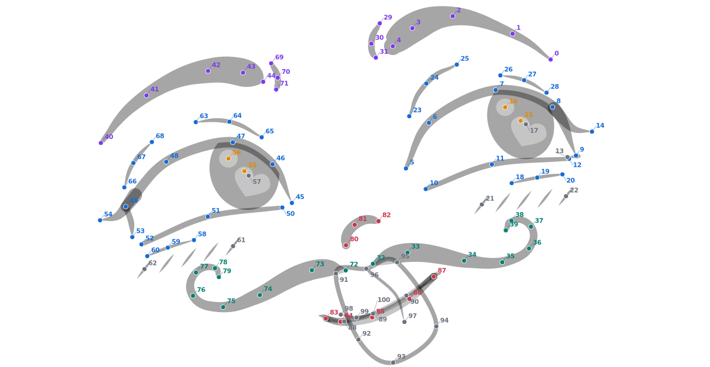

# Datenformat und Rendering verstehen

Dieses Dokument erklärt den gespeicherten Zustand unabhängig von den Implementierungsdetails. Der vollständige ID-Katalog steht in [topology.md](topology.md); die Entwicklungsübersicht in [README.md](../README.md).

Die aktuellen Erweiterungen verändern die 101 IDs nicht: `expression` ist der separate 60-dimensionalige Sozialkatalog; `geometry.under_eye_transition` und `rig.*_hatching.foldness/slot_weights` steuern die [kontinuierlichen Unteraugen-Morphs](under_eye.md). Das Feld `emotion` behält ausschließlich die 40 offiziellen EmoNet-Gewichte. Ein [augmentiertes Rasterlabel](dataset.md) ist eine eigene Beobachtung mit tatsächlich transformierten Koordinaten und Rand-/Verdeckungsmasken, keine Ersatz-Pose-JSON.

## Was die 101 Punkte beschreiben

**101 ist die Anzahl; die IDs laufen von 0 bis 100.** Links/rechts sind anatomisch aus Sicht der Figur definiert. Deshalb liegen `left_*`-Punkte rechts im Bild. Alle Posen verwenden exakt dieselben IDs und Namen.



Violett markiert Brauen, Blau Augen und Details, Orange Pupillen/Reflexe, Grün Wangenbänder und Rot die mittleren Komponenten. Grau markiert abwesende bzw. verdeckte Punkte. Die Nummer gehört auch dann weiterhin zur gleichen Stelle des Rigs.

Die Punkte sind unterschiedlich zu interpretieren:

| Rolle | Bedeutung | Beispiel |
|---|---|---|
| `centerline_anchor` | Anker auf der Mittellinie einer gefüllten schwarzen Kurve | `left_brow_apex`, `mouth_upper_center` |
| `contour_anchor` | Anker auf einem geschlossenen Umriss | `tongue_tip` |
| `ellipse_center` | Mittelpunkt einer Ellipse vor Clipping | `left_pupil_center` |
| `endpoint_anchor` | Freies Ende einer teilweise abgeleiteten Kurve | `left_eye_lash_tip` |
| `zone_anchor` | Grenzanker einer Zone, aus der mehrere Striche entstehen | `right_hatch_inner` |

Ein Mittellinienpunkt ist kein äußerer Silhouettenpunkt. Er kann an einer schwarzen Form liegen, deren Rand erst durch die lokale Breite entsteht. Ein Schraffurzonenanker ist kein wechselnd zugeordneter einzelner Strich. Ein Pupillenmittelpunkt existiert geometrisch auch dann, wenn das Lid ihn verdeckt.

Die Namen `nose_tip` und `chin_*` beziehen sich auf die Cartoon-Zeichenkomponenten: Ende der kleinen Nasenlinie und Akzentstrich unter dem Mund. Sie sind keine realen 3D-Nasen- oder Kinnlandmarks.

Weitere Figuren: [Brauen](landmarks/brows.png), [linkes Auge](landmarks/eye_left.png), [rechtes Auge](landmarks/eye_right.png), [Wangenbänder](landmarks/moustache.png), [Mund/Nase/Zunge](landmarks/mouth_nose_tongue.png). Die zugehörigen SVGs enthalten Tooltip-Namen.

## Vollständiger Pose-Zustand

Eine tatsächliche vollständige Datei ist [poses/smile.json](../poses/smile.json). Sie besteht aus:

| Feld | Inhalt und Verbindlichkeit |
|---|---|
| `schema_version` | Formatversion, derzeit `1.0` |
| `topology_id` | Landmark-Schema, derzeit `cartoon_face_v1` |
| `coordinate_system` | `normalized` |
| `canvas` | gewünschte SVG-/PNG-Breite und -Höhe |
| `keypoints` | alle 101 benannten Einträge, jeder mit `id`, `xy`, `state` |
| `rig` | komplette interne Form-/Breiten-/Symbolparameter aller Komponenten |
| `variants` | Unteraugenmodus pro Seite, Reflexmodus pro Seite, Mundinnenraum |
| `style` | feste Schwarz-Weiß-Farben: `ink=black`, `background=white` |
| `geometry` | optional seit Rezept 1.1: Kurvenglättung und Mundrundung; fehlt bei alten Posen, deren Geometrie exakt erhalten bleibt |
| `name`, `provenance` | Beschreibung und Herkunft; keine versteckte Geometrie |
| `controls` | optional: zuletzt angewandte Steueraktionen; werden nicht erneut angewandt |
| `emotion`, `recipe` | optional: beabsichtigte Emotion/Mischung und prozedurale Entstehung |

**Nur die 101 xy-Werte reichen nicht für eine exakte Rekonstruktion.** Zusätzlich beeinflussen Breiten, Tangenten, Pupillenradien, Reflexe, Sichtbarkeit und Darstellungsvarianten das SVG. Deshalb wird immer der vollständige Zustand gespeichert. Der Renderer braucht beim Wiederladen keine Referenzbilder und führt kein Fitting aus.

Das JSON-Schema liegt in [pose.schema.json](../src/cartoon_face/topology/pose.schema.json). `model.validate_pose` prüft zusätzlich passende IDs, endliche Zahlen und Rig-Wertebereiche. IDs, Koordinaten und Sichtbarkeit sollten zusammen gelesen werden.

## Drei Koordinatensysteme und ihre Einheiten

1. **Originalbild:** 1536 × 864 Pixel inklusive Bildschirmrahmen.
2. **Kanonische Arbeitsfläche:** gemeinsamer Ausschnitt `(42,56,1492,806)`, 1450 × 750 Pixel. Ursprung links oben, x nach rechts, y nach unten. Originalpunkt `(x,y)` wird zu `(x−42,y−56)`.
3. **Gespeichertes xy:** `[u,v]=[x_kanonisch/1450,y_kanonisch/750]`, beide im Bereich `[0,1]`.

SVG-Pfade werden im kanonischen System berechnet. Das SVG trägt `viewBox="0 0 1450 750"` und `preserveAspectRatio="none"`. Bei einem Zielcanvas `(W,H)` liegt die Landmark deshalb bei `(u*W,v*H)`. Ein anderes Seitenverhältnis streckt den Ausdruck; proportional größere Auflösungen skalieren ihn gleichmäßig.

**Rig-Längen sind kanonische Pixel**, keine normierten Werte und keine Pixel der Zielauflösung. Winkel sind Grad, Tangentenskalen und Deckkräfte dimensionslos. CLI-Optionen `--width/--height` überschreiben nur das ausgegebene SVG-Canvas; beim Export eigener Pixel-Labels muss die verwendete Zielauflösung entsprechend gesetzt werden.

## Sichtbarkeit und latente Punkte

- `visible` / Code 2: Komponente ist vorhanden; Pupillen-/Reflexzentrum liegt innerhalb der zugehörigen Öffnungs-/Pupillen-Clips.
- `occluded` / Code 1: Pupillen-/Reflexzentrum wird durch das Lid bzw. den Pupillen-Clip verdeckt. Eine teilweise sichtbare Pupille kann einen verdeckten geometrischen Mittelpunkt besitzen.
- `absent` / Code 0: optionale Komponente ist deaktiviert, hat praktisch null Deckkraft oder hängt von einer abwesenden Elternkomponente ab.

Abwesende Koordinaten werden erhalten. Sie werden niemals zu einer anderen Linie umbenannt. Ihr xy kann weiterhin interpoliert werden, während ihre Deckkraft null bleibt. Pupillen und Reflexe werden gegen die tatsächliche Clip-Geometrie geprüft; die übrigen Punkte verwenden Komponentensichtbarkeit. Das ist keine vollständige pixelgenaue Occlusion-Segmentierung.

Beim eigenen Verschieben von Punkten danach `refresh_states(pose)` aufrufen. `save_pose` validiert den Zustand und speichert die vorhandenen Werte; es verändert die Geometrie nicht automatisch.

## Interne SVG-Geometrie im Rig

| Komponentenart | Wichtigste Felder | Wirkung |
|---|---|---|
| Brauen, Ober-/Unterlider, Wangenbänder, Nase, Akzente | `widths[]`, `tangent_scales[]`, `opacity` | lokale volle Bandbreite, C1-Hermite-Tangentenlänge, Deckkraft |
| Pupillen und runde Reflexe | `rx`, `ry`, `angle`, `opacity` | Ellipsenradien, Rotation und Deckkraft |
| primärer Reflex | `heart_scale`, `heart_offset[dx,dy]`, `heart_angle`, `heart_opacity` | Herzsymbol relativ zum Pupillenmittelpunkt, zusätzlich zum runden Reflex |
| seitlicher Lidstrich | `width`, `bulge`, `opacity` | Breite und horizontale Zwischenwölbung zwischen Oberlid-Außenende und `eye_side_end` |
| Wimper | `root_t`, `bend`, `width`, `opacity` | Ansatz auf dem Oberlid, vertikale Zwischenbiegung und Breite |
| Schraffuren | `count`, `length`, `angle`, `width`, `offsets[8][3]`, `opacity` | bis zu acht feste interne Strich-Slots; Offset `[dx,dy,Längenfaktor]` je Slot |
| Obermund | `fill_opacity`, `corner_accent[2]`, `corner_size`, `corner_width` | Öffnungsfüllung und abgeleitete Winkelakzente, Reihenfolge Figur rechts→links |
| Untermund | `widths[3]`, `opacity` | drei Zwischenanker werden durch die beiden Obermundwinkel ergänzt |
| Zunge | `tangent_scales[6]`, `width`, `opacity` | geschlossener weißer Umriss mit schwarzem Rand |
| Zungenmittellinie | `bend`, `width`, `opacity` | Start bei `tongue_root_center`, Ende bei `tongue_crease_tip`; nur mit sichtbarer Zunge gezeichnet |

Ein Bézier-Handle ist kein zusätzlicher ML-Punkt. Der Renderer berechnet Handles aus den Ankern und `tangent_scales`; gefüllte Bandgrenzen entstehen aus Mittellinie und `widths`. Die feste Komponentenliste und ihre Ankerreihenfolge stehen ausschließlich in `face_topology.json`.

Neue Emotionsposen mit Rezeptversion `1.1` speichern zusätzlich `geometry={"version":"smooth_v1","ribbon_smoothing":1.0,"mouth_rounding":...}`. `ribbon_smoothing` liegt in `[0,1]`: 0 erhält die bisherigen Bandpfade, 1 glättet die abgeleiteten Konturgrenzen und verbindet Strichkappen tangential. Die semantischen Mittellinienanker werden dabei nicht neu zugeordnet. `mouth_rounding` liegt ebenfalls in `[0,1]`; 1 verbindet die beiden Mundkurven an den gemeinsamen Mundwinkeln mit einer runden Tangente, beispielsweise für einen ovalen O-Mund. Dazwischen ist die Rundung stufenlos.

Fehlt `geometry`, verwendet der Renderer exakt das bisherige Verfahren. Die archivierten Rezept-1.0-Posen behalten deshalb byteidentische SVGs. Alte und neue Posen können interpoliert werden; fehlende Glättungswerte werden dabei als 0 behandelt. Das Feld ist geometrisch verbindlich und darf für exaktes Wieder-Rendering nicht entfernt werden.

`under_eye` kennt `none`, `continuous`, `hatching`, `mixed`. Zum Umschalten `set_variant` benutzen: es aktualisiert die Deckkräfte der richtigen Komponenten. Die Deckkräfte sind verbindlich für Übergänge, in denen mehrere Formen zugleich teilweise sichtbar sein können. Herz und Zunge behalten feste Komponenten statt einer beliebigen Pfad-Morphing-Topologie.

## Python-Beispiel: ändern, speichern, exakt wieder rendern

```python
from cartoon_face.model import load_pose, save_pose, xy, set_xy, refresh_states
from cartoon_face.renderer import render_files, render_svg

pose = load_pose("poses/smile.json")
# Koordinate in kanonischen Pixeln lesen und den linken Brauenscheitel anheben.
point = xy(pose, "left_brow_apex")
set_xy(pose, "left_brow_apex", point + [0, -10])
refresh_states(pose)
save_pose(pose, "output/edited.json")
render_files(pose, "output/edited.svg", "output/edited.png")
assert render_svg(pose) == render_svg(load_pose("output/edited.json"))
```

Zum Rendern genügt anschließend `face render --pose output/edited.json --output output/edited.svg`. `controls` und `recipe` sind Herkunftsinformationen; der Renderer führt sie beim Laden nicht noch einmal aus.

## Geordnete Arrays für andere Programme

```python
from cartoon_face.model import load_pose, landmark_arrays, topology
pose = load_pose("poses/smile.json")
xy_normalized, visibility = landmark_arrays(pose)
xy_pixels, _ = landmark_arrays(pose, pixels=True)
assert xy_normalized.shape == (101, 2)
assert visibility.shape == (101,)
# Arrayzeile i gehört zur Landmark-ID i, unabhängig von JSON-Schlüsselreihenfolge.
names = [k["name"] for k in sorted(topology()["keypoints"], key=lambda k: k["id"])]
```

`absent`-Werte nicht als sichtbare Ziele behandeln und nicht auf `[0,0]` setzen. Die gespeicherten latenten Positionen gehören weiterhin zur gleichen semantischen ID. Die 40 **Emotions-IDs** sind getrennt davon und laufen von 1 bis 40; sie sind keine Landmark-IDs.

## Emotionen und Mischungen im gespeicherten Format

Die neue Emotionsschicht nutzt denselben Pose-Vertrag. `emotion.taxonomy_id=emonet_face_40_v1`, `category_id` und `slug` beschreiben einen einzelnen beabsichtigten Ausdruck. Bei Mischungen ist `category_id=null`; `weights[40]` enthält die Steueranteile in der offiziellen Kategorienreihenfolge. Ein neutraler Zusatz-Ausdruck ist außerhalb der 40 Kategorien und hat einen Nullvektor.

Diese Gewichte sind **Gestaltungsanteile**, keine gemessenen Erkennungswahrscheinlichkeiten und keine übernommenen 0–7-Expertenratings. `label_kind=intended_procedural_target|intended_procedural_mixture` und `human_validated=false` machen den Unterschied ausdrücklich. `recipe` enthält Versionsnummer, Seed, Variation, verständliche Gesichtskontrollen und Korrelations-Latents. Der vollständige Pose-Zustand bleibt die verbindliche Wiederherstellung unabhängig von späteren Rezeptänderungen.
