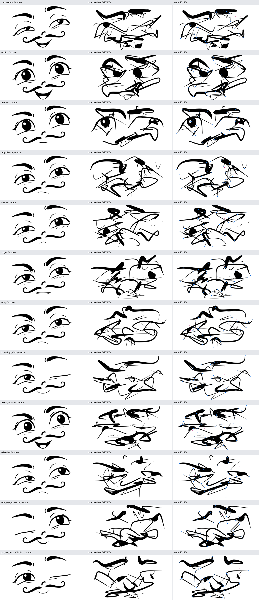
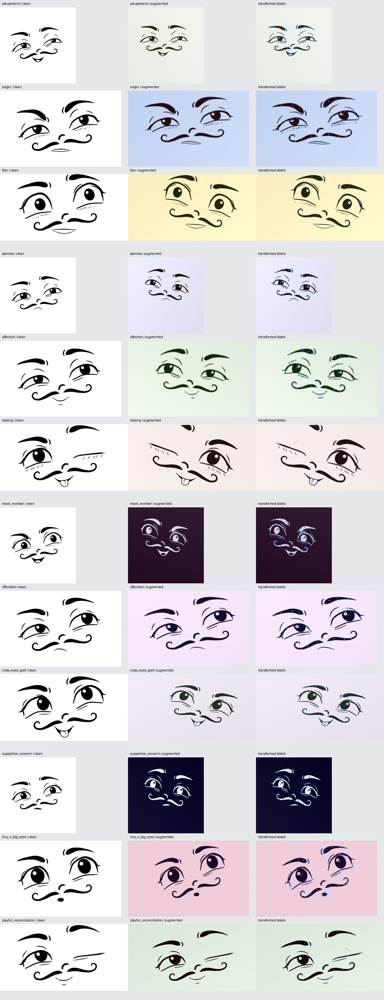

# Synthetischer Datensatz und korrekte Augmentationen

[Dokumentationsindex](README.md) · [Repository-Startseite](../README.md)

Der finale Datensatz `cartoon_landmarks_105k_v2` enthält **105.000** vollständig aufgelöste SVG-/Pose-Paare: jeweils 1.000 Varianten der 40 EmoNet- und 60 sozialen Kategorien sowie 5.000 extreme, nicht mit Emotionen gelabelte Verformungen. Alle benutzen `cartoon_face_v1` und dieselben 101 festen IDs. Seed: 42. Generatorquellen, Topologie, Rezepte und gefittete Identitätsposen sind durch einen SHA-256-Fingerprint festgehalten.

Die 303 TAR.GZ-Shards enthalten **6.999.557.481 Bytes** komprimierte Daten. Die enthaltenen SVG-/JSON-Nutzdaten wären unkomprimiert **15.322.331.008 Bytes**, zuzüglich TAR-Verwaltung. Der lokale komprimierte Trainingscache benötigt ungefähr 834 MB. Die gespeicherte Datensatzmenge bleibt damit unter 10 GB. Die großen Archive gehören nicht in den Quellcode-Git-Download.

## Erzeugen, laden und rendern

```bash
OPENBLAS_NUM_THREADS=1 OMP_NUM_THREADS=1 .venv/bin/face build_dataset \
  --per-expression 1000 --ood-count 5000 --seed 42 --workers 16

.venv/bin/face export_rasters --dataset datasets/cartoon_landmarks_v2 \
  --split train --limit 100 --seed 42 --width 512 --height 320 \
  --format png --output output/raster_examples
```

Jeder Shard enthält Paare `sample_id.svg` und `sample_id.json`. Das JSON ist ein vollständiger renderbarer Zustand; es enthält nicht bloß einen Seed. SVG-Dimensionen sind 768 × 400, die geometrischen Rig-Längen bleiben im kanonischen Raum 1450 × 750. Rasterbilder können in beliebigen dokumentierten Dimensionen erzeugt werden.

```python
from cartoon_face.large_dataset import iter_records
from cartoon_face.renderer import render_svg
from cartoon_face.augmentation import augmented_records

for sample_id, svg, pose in iter_records("datasets/cartoon_landmarks_v2", "train"):
    assert render_svg(pose) == svg
    break

for sample_id, image, annotation in augmented_records(
        "datasets/cartoon_landmarks_v2", seed=42, width=512, height=320):
    # image is a Pillow RGB image; annotation carries all transformed labels.
    break
```

TAR-Shards eignen sich auch für [Hugging Face WebDataset-Streaming](https://huggingface.co/docs/hub/main/datasets-webdataset). Hier sind SVG und vollständiges JSON die beiden Felder; der eigene Iterator rendert bei Bedarf. Es gibt keine eingebetteten Originalraster im SVG.

## Variation und OOD

Die normalen Varianten kombinieren korrelierte Ausdrucksaktionen und begrenzte Formänderungen: Augenproportionen und Neigung, Brauenposition, Mundbreite, Wangenform, globale Größe und Position. Mitbewegte Pupillen/Reflexe und transformierte Ellipsen erhalten den Zusammenhang. Alle 1.000 Landmark-Vektoren jeder Kategorie sind verschieden; der Bericht zählt Koordinaten-Hashes und nicht unterschiedliche SVG-Titel.

Die extreme Gruppe verschiebt **jede der 202 X-/Y-Koordinaten** unabhängig um 5–10 % der gesamten jeweiligen Bilddimension. Auch latent gespeicherte optionale Punkte werden verschoben. Falls eine Richtung den Rand überschreiten würde, wird ihre Richtung umgekehrt statt die Position zu klemmen. Der exakte Versatz steht in `recipe.ood_jitter.actual_delta`. Selbstüberschneidungen und unplausible Formen sind beabsichtigt. Der ursprüngliche Emotionsname wird nur als Herkunft gespeichert und nicht als gültiges Ziel verwendet.



## Bildaugmentationen

Die standardmäßigen Änderungen sind bewusst moderat: Rotation bis ±12°, geringe Verschiebung, begrenzte Skalierung und Stauchung, zusätzliche Ränder einschließlich mehr Platz unten, unterschiedliche Ausgabeformate, pastellfarbene gelbliche/bläuliche/zufällige Hintergründe, milde Beleuchtungsverläufe, wenig Rauschen, leichte Unschärfe, geringere Auflösung und JPEG-Kompression. Gelegentlich werden Kontrast umgekehrt oder kleine Bildbereiche verdeckt. Starke Landmark-Deformation gehört zur separaten OOD-Gruppe.



Bild und Labels erhalten dieselbe affine Matrix und denselben invertierbaren zweistufigen Sinus-Shear. Der Renderer verwendet keine unabhängige Zufallsverschiebung der Annotationen. Bei Spiegelung werden anatomische Links-/Rechts-IDs und Sichtbarkeiten vertauscht; zentrale Kurvenrollen behalten ihre IDs. Das ist eine notwendige [Keypoint-Augmentationskonvention](https://albumentations.ai/docs/3-basic-usage/keypoint-augmentations/), die hier ohne zusätzliche Bibliothek implementiert ist.

`xy_pixels` und `xy_normalized` können nach Augmentation außerhalb des Bildes liegen. Diese Werte bleiben gespeichert; `in_frame`, `regression_mask` und `visible_mask` markieren die Nutzbarkeit. Abwesend = 0, verdeckt = 1, sichtbar = 2. Künstliche Verdeckung erzeugt Zustand 1; Randüberschreitung setzt die Trainingssichtbarkeit auf 0. Pixelkoordinaten verwenden die OpenCV-Pixelmittelpunkte; die Spiegelung ist explizit `x' = W - 1 - x`. Die normalisierte Koordinate bleibt `x / W`.

Die augmentierte Annotation hat Schema `raster_landmarks_v1` und ist **kein renderbarer SVG-Zustand**. Der originale Pose-Zustand bleibt separat erhalten. Der Export erzeugt PNG/JPG, Annotationen als JSONL und einen COCO-kompatiblen Datensatz mit allen 101 Namen in fester Reihenfolge. Die vollständige Transformation und der Rauschseed stehen in jeder Annotation.

## Aufteilung und Grenzen

Die SVG-Shards enthalten 84.000 Trainings-, 10.500 Validierungs- und 10.500 Testposen. Pro normaler Kategorie sind die ersten 800 Indizes Training, die nächsten 100 Validierung und die letzten 100 Test. Erst nach dieser Trennung werden Augmentationen erzeugt; Varianten desselben Grundbilds können deshalb nicht zwischen den Splits leaken.

Für den tatsächlichen Trainingslauf werden pro Ausdruck fünf feste Validierungsposen und fünf zusätzliche Testposen ausgewählt. Jede besitzt eine saubere und eine feste augmentierte Ansicht: je 1.000 normale Validierungs-/Testbilder. Hinzu kommen separat je 200 OOD-Ansichten. Das Trainingscache enthält alle 84.000 Trainingsposen; die Augmentation wird für jede Epoche neu gesampelt. Die 1.000 Normalbilder jeder Evaluation stammen also aus 500 verschiedenen Posen, nicht aus 1.000 unabhängigen Gesichtern.

Die Sichtbarkeit ist Komponentenanwesenheit plus geometrische Pupillen-/Lid-Clips und augmentierte Verdeckung. Sie ist keine vollständige Pixel-Overlap-Segmentierung. Der Datensatz bildet eine einzige Cartoon-Identität ab. OOD-Labels können aus ihrem Bild mehrdeutig sein. Breite Übertragbarkeit auf echte animierte Videos muss später mit solchen Videos geprüft werden; synthetische Genauigkeit allein belegt sie nicht.
