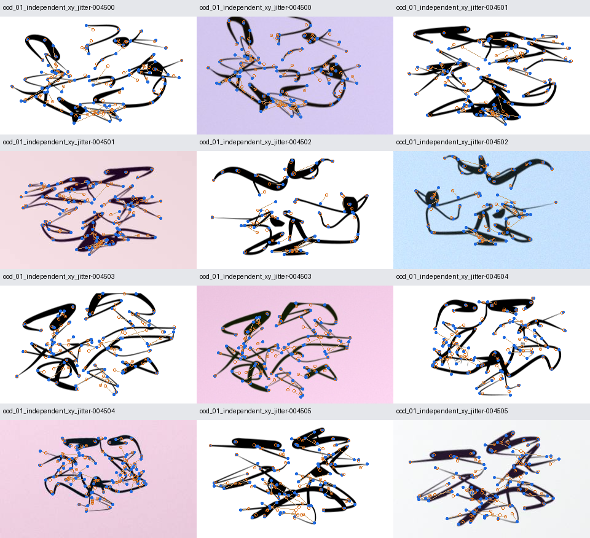
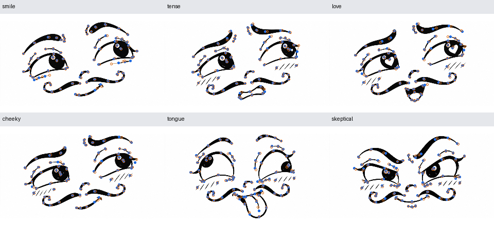

# Tatsächlich trainierter 101-Punkt-Detector

[Dokumentationsindex](README.md) · [Repository-Startseite](../README.md)

Nach dem ursprünglichen 15-Epochen-Lauf wurden **vier Varianten mit jeweils 40 zusätzlichen Epochen** trainiert. Es gibt nun zwei ausgewählte Checkpoints des unveränderten Netzwerks mit **1.011.228 Parametern**:

- **Robust:** stärkeres Augmentationsprofil und höheres OOD-Verlustgewicht; ausgewählt nach dem vorab festgelegten, gemischten Validierungsscore.
- **Normalpräzise:** längeres mildes Training; ausgewählt nach der normalen Validierungsabweichung.

Die Validierungs- und Testdateien blieben einschließlich Annotationen byteidentisch. Die Checkpoint-Auswahl wurde vor der Testauswertung gespeichert. [Suchprotokoll und Reproduktion](detector_search.md) erklären zusätzliche Daten, Profile, Auswahlregel und Prüfsummen.

## Unabhängige synthetische Testbilder

| Bedingung | Bilder | Baseline, 15 Epochen | Neue normalpräzise Variante | Neue robuste Variante |
|---|---:|---:|---:|---:|
| Sauber | 500 | 0,228 px | **0,176 px** | 0,303 px |
| Mild augmentiert | 500 | **0,234 px** | 0,241 px | 0,358 px |
| Normal, beide Bedingungen | 1.000 | 0,231 px | **0,209 px** | 0,330 px |
| Extrem deformiert / OOD | 200 | 15,620 px | 11,901 px | **10,291 px** |

Die robuste Variante reduziert den OOD-Fehler gegenüber der Baseline um **34,1 %**, verliert aber normale Präzision. Die normalpräzise Variante verbessert den kombinierten normalen Fehler um **9,6 %**; auf mild augmentierten Bildern ist sie geringfügig schlechter als die Baseline. Es gibt daher keinen Checkpoint, der in sämtlichen Bedingungen gewinnt.

PCK innerhalb 1 % der Bilddiagonale beträgt für die robuste Variante **99,85 % normal / 35,10 % OOD**, für die normalpräzise **99,90 % normal / 26,32 % OOD**. Die Baseline erreicht auf OOD 13,40 %.

Die 500 sauberen und 500 augmentierten Normalbilder gehören zu denselben 500 zurückgehaltenen Testposen: fünf verschiedene Posen pro Ausdruck. Sie wurden nicht für Training oder Checkpoint-Auswahl verwendet. Es gibt außerdem genauso aufgeteilte Validierungsbilder. Die 200 OOD-Testansichten gehören zu 100 extremen Testposen. Der Nenner für PCK/NME ist die Bilddiagonale; bei 320 × 192 sind 1 % ungefähr 3,73 Pixel. Abwesende und außerhalb liegende Punkte werden ausgeschlossen, geometrisch verdeckte Punkte eingeschlossen.

## Grenzen ausdrücklich getrennt

Die hohe normale Testgenauigkeit gilt für neue Variationen derselben prozeduralen Cartoon-Identität und die dokumentierten milden Testaugmentationen. Sie belegt keine Erkennungsrate von Emotionen und keine Übertragbarkeit auf beliebige Cartoon-Stile. Stärkere Augmentationen werden im Training verwendet; daraus folgt keine separat gemessene Genauigkeit unter jeder beliebigen Störung.

Selbstüberschneidende OOD-Zustände bleiben schwierig: unabhängige Verschiebungen können semantische Anker im sichtbaren Bild mehrdeutig machen. Trotz Verbesserung liegen nur etwa 35 % der bewerteten OOD-Punkte innerhalb von 3,73 Pixeln. Die unten sichtbaren Versätze werden nicht beschönigt; dies ist weiterhin eine Forschungsgrenze.

## Originalreferenzen und CPU-Inferenz

Die sechs ursprünglichen Gesichtscrops wurden zusätzlich mit dem robusten Checkpoint geprüft. Die Originalraster wurden nicht trainiert; synthetische Variationen ihrer historischen Rig-Pose-Familien sind im erweiterten Training enthalten. Dies prüft daher den ursprünglichen Raster-/Zeichenstil derselben Identität, keine völlig unbekannte Formfamilie.

Der mittlere Fehler über die sechs Referenzen sinkt von **4,379 auf 1,700 Pixel** bei 320 × 192. Die Ground Truth basiert auf dem zuvor angepassten Rig; sie ist keine unabhängige menschliche Annotation. Die CPU-Inferenz inklusive Heatmap-Dekodierung dauerte mit vier Server-Threads median **9,01 ms**; Modellladen und Bildvorverarbeitung sind nicht enthalten. Dies ist kein Laptop- oder Video-Benchmark.

Maschinenlesbare Berichte: [Vergleich beider Modelle mit der Baseline](../output/detector_v3/comparison.json), [vor Testauswertung festgehaltene Auswahl](../output/detector_v3/selection_locked.json), [Originalreferenzen](../output/detector_v3/external_references.json), [Validierungskurven](../output/detector_search_v3/validation_curves.png). Die [ursprüngliche Evaluation](../output/detector/evaluation.json) bleibt erhalten. Befehle, Architektur und neue Checkpoint-Downloads stehen in [training/README.md](../training/README.md).
