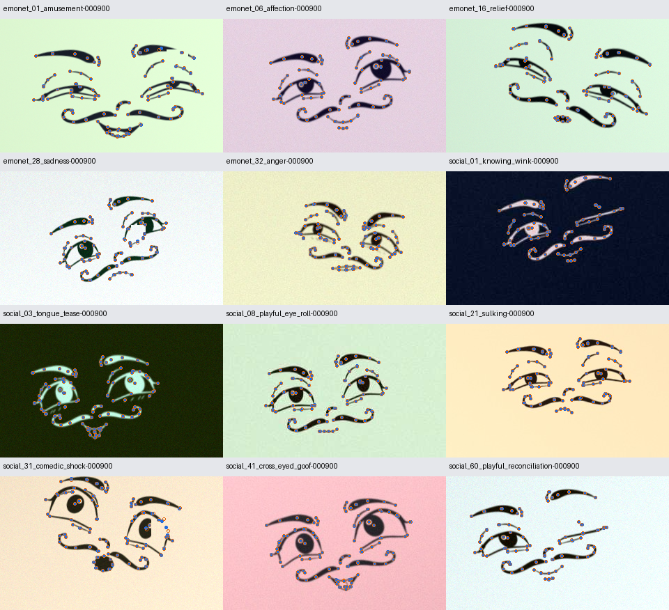
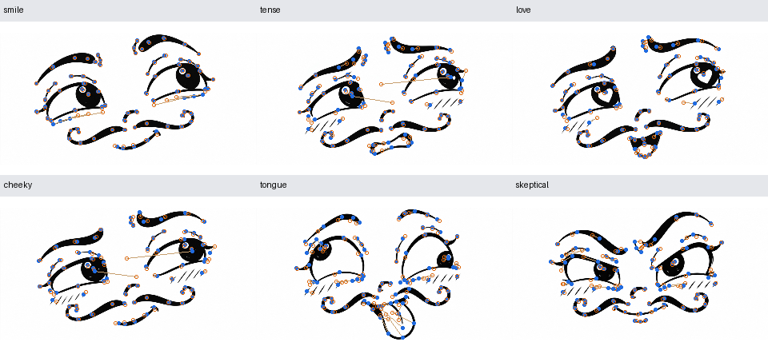

# Tatsächlich trainierter 101-Punkt-Detector

[Dokumentationsindex](README.md) · [Repository-Startseite](../README.md)

Das Modell wurde auf 84.000 getrennten Trainingsposen für 15 Epochen trainiert, mit einer neuen milden Augmentation pro Bild und Epoche. Ein NVIDIA A100 und PyTorch 2.6.0/CUDA 12.4 wurden verwendet. Das Netzwerk hat 1.011.228 Parameter; der gewählte Checkpoint stammt aus Epoche 15. Der Lauf dauerte 16.17 Minuten.

## Unabhängige synthetische Testbilder

| Bedingung | Bilder | Mittlerer Fehler bei 320 × 192 | PCK innerhalb 1 % der Bilddiagonale |
|---|---:|---:|---:|
| Sauber | 500 | 0.228 px | 99.90 % |
| Mild augmentiert | 500 | 0.234 px | 99.87 % |
| Extrem deformiert / OOD | 200 | 15.620 px | 13.40 % |

Die 500 sauberen und 500 augmentierten Normalbilder gehören zu denselben 500 zurückgehaltenen Testposen: fünf verschiedene Posen pro Ausdruck. Sie wurden nicht für Training oder Checkpoint-Auswahl verwendet. Es gibt außerdem genauso aufgeteilte Validierungsbilder. Die 200 OOD-Testansichten gehören zu 100 extremen Testposen. Der Nenner für PCK/NME ist die Bilddiagonale; bei 320 × 192 sind 1 % ungefähr 3,73 Pixel. Abwesende und außerhalb liegende Punkte werden ausgeschlossen, geometrisch verdeckte Punkte eingeschlossen.

## Grenzen ausdrücklich getrennt

Die hohe normale Testgenauigkeit gilt für neue Variationen derselben prozeduralen Cartoon-Identität und die dokumentierten milden Augmentationen. Sie belegt keine Erkennungsrate von Emotionen und keine Übertragbarkeit auf beliebige Cartoon-Stile. Die selbstüberschneidenden OOD-Zustände bleiben wesentlich schwieriger: unabhängige Verschiebungen können semantische Anker aus dem sichtbaren Bild mehrdeutig machen. Der aktuelle kleine Detector rekonstruiert solche Zustände nur grob. Ein stärkeres/gezielter auf OOD trainiertes Modell und sichtbare-Anker-Segmentierung wären mögliche nächste Untersuchungen.

## Originalreferenzen und CPU-Inferenz

Die sechs ursprünglichen Gesichtscrops wurden zusätzlich mit dem fertigen Checkpoint geprüft. Sie wurden nicht als Trainingsbilder verwendet. Der mittlere Fehler über die sechs Referenzen beträgt 4.379 Pixel bei 320 × 192. Die CPU-Inferenz inklusive Heatmap-Dekodierung dauerte auf dem Server mit vier Threads median 8.82 ms; Modellladen und Bildvorverarbeitung sind nicht in dieser Zahl. Dies ist kein Laptop- oder Video-Benchmark.

Maschinenlesbare Berichte: [vollständige Evaluation](../output/detector/evaluation.json), [Originalreferenzen](../output/detector/external_references.json), [Lernkurven](../output/detector/history.json). Befehle und Architektur stehen in [training/README.md](../training/README.md).
