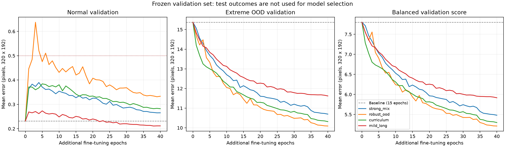

# Längeres Training mit stärkeren Augmentationen

[Dokumentationsindex](README.md) · [Trainingsanleitung](../training/README.md)

Diese Erweiterung sucht innerhalb mehrerer Trainingskonfigurationen einen robusteren Checkpoint des bestehenden **LandmarkNet101-v1 mit 1.011.228 Parametern**. Die bisherigen 1.200 Validierungs- und 1.200 Testansichten werden unverändert verwendet. Es werden keine Holdout-Bilder neu augmentiert oder durch andere Posen ersetzt.

## Neue Trainingsvarianten

Zu den bisherigen 84.000 Trainingsposen kommen 32.000 neue vollständige Zustände:

| Gruppe | Anzahl | Aufgabe |
|---|---:|---|
| normale neue Ausdrucksvariationen | 16.000 | zusätzliche Formen aller 100 Ausdrucksziele |
| moderate unabhängige Deformationen | 8.000 | Brücke zwischen plausiblem Rig und extremem OOD, Achsenversatz 0,8–4,5 % |
| weitere extreme Deformationen | 4.000 | Achsenversatz 5–10 % jeder Bilddimension |
| synthetische Varianten der historischen Rig-Posen | 4.000 | zusätzliche Lid-, Mund- und Konturformen des ursprünglichen Darstellungsmodus |

Die 116.000 Quellposen bestehen aus 100.000 normalen/historischen und 16.000 moderat/extrem deformierten Zuständen. Historische Rig-Varianten entstehen als SVG-Renderings; die Originalraster werden nicht als Trainingsbilder verwendet. Allerdings sind diese ursprünglichen Pose-Familien nun ausdrücklich im synthetischen Training vertreten. Ein Ergebnis auf den sechs Originalzeichnungen ist deshalb ein zusätzlicher Test des Raster-/Zeichenstils, kein Nachweis für eine unbekannte Identität.

Jede neue Pose ist vollständig in `datasets/training_extra_v3/poses/*.jsonl.gz` gespeichert. Die dazugehörigen sauberen Raster und Labels liegen unter `train/*.npz`. Das Audit prüft alle 32.000 Posen und 903 byteidentische Raster-/Label-Replays. Insgesamt benötigt die Erweiterung etwa 419 MB. Die großen Dateien werden nicht in Git aufgenommen.

## Stärkere Bildaugmentationen

Die neuen Profile erhalten saubere und mild augmentierte Ansichten und ergänzen stärkere Ansichten mit:

- Rotation bis ±25°, im härtesten Teilprofil bis etwa ±31°;
- Perspektivänderung mit identischer Homographie für Bild und Punkte;
- Skalierung, veränderten Proportionen und mehr bzw. asymmetrischen Bildrändern;
- stärkeren invertierbaren Sinus-Verformungen;
- farbigen und gelegentlich invertierten Hintergründen, Helligkeitsverläufen;
- mehr Rauschen, Unschärfe, geringerer Auflösung und JPEG-Kompression;
- geringfügiger Änderung der wahrgenommenen Strichbreite und kleinen Verdeckungen.

Die starken Profile mischen etwa 8 % klare, 22 % ursprüngliche milde und 70 % stärkere Ansichten. Das robuste Profil enthält einen besonders harten Anteil. Ein Curriculum erhöht die Stärke schrittweise. Anatomische Spiegelung vertauscht die passenden Landmark-IDs; aus dem Bild transformierte Punkte werden maskiert und nicht an den Rand geklemmt.

Die v2-Augmentation und alle eingefrorenen Evaluationsdateien bleiben unberührt. Die neue Implementierung liegt ausschließlich unter [training/augmentation.py](../training/augmentation.py).

## Vier Kandidaten

Alle starten von den Gewichten des bisherigen besten Checkpoints aus Epoche 15. Optimizer und Cosine-Lernratenplan werden für das zusätzliche Training neu initialisiert.

| Kandidat | Augmentation | Anfangslernrate | OOD-Verlustgewicht | OOD-Ansichten pro Epoche |
|---|---|---:|---:|---:|
| `strong_mix` | stark gemischt | 0,0004 | 0,50 | 20 % |
| `robust_ood` | stark mit härterem Anteil | 0,0003 | 0,75 | 30 % |
| `curriculum` | schrittweise stärker | 0,00035 | 0,50 | 25 % |
| `mild_long` | mild, länger | 0,00025 | 0,25 | 15 % |

Jeder Kandidat läuft bis zu **40 zusätzliche Epochen**, mit mindestens 24 Epochen und einer Early-Stopping-Geduld von zehn Epochen. Jede Quellpose wird je Epoche mindestens einmal genutzt; zusätzliche OOD-Ansichten werden mit eigenen Augmentationsseeds wiederholt. Die Ansichten sind pro Epoche neu und reproduzierbar. Checkpoints und komplette Lernkurven bleiben getrennt erhalten.

## Auswahl ohne Test-Leakage

Vor Beginn wurde in `output/detector_search_v3/search_plan.json` folgende Regel festgehalten:

```text
Score = 0.25 * clean_validation_NME
      + 0.25 * augmented_validation_NME
      + 0.50 * extreme_OOD_validation_NME

Zulässig nur bei normal_validation_mean_error <= 0.5 Pixel.
```

Die bisherige Baseline ist ebenfalls auswählbar. Zusätzlich wird der Checkpoint mit der niedrigsten normalen Validierungsabweichung erhalten. Alle vier Evaluationsdateien, einschließlich der beiden Annotationen, sind durch SHA-256-Prüfsummen festgehalten.

Erst nach Ende aller Kandidaten schreibt [compare_search.py](../training/compare_search.py) die Auswahl in `selection_locked.json`. Danach werden der robust ausgewählte und der normalpräziseste Checkpoint auf denselben unveränderten Testbildern geprüft. Testmetriken und die Originalreferenzen beeinflussen die Auswahl nicht.

Das ist eine Suche innerhalb dieser vier Konfigurationen und dieser Modellfamilie. Sie belegt kein global bestes Modell und keine Generalisierung auf beliebige Cartoon-Stile.

## Reproduzieren

Die [Basistrainingsdaten und Umgebungen](../training/README.md) werden vorausgesetzt. Die Erweiterung schreibt ausschließlich neue Daten und erhält die alten Holdouts:

```bash
OPENBLAS_NUM_THREADS=1 OMP_NUM_THREADS=1 .venv/bin/python -m training.extra_variants --workers 24
OPENBLAS_NUM_THREADS=1 OMP_NUM_THREADS=1 .venv/bin/python tools/audit_extra_training.py --workers 12

OPENBLAS_NUM_THREADS=1 OMP_NUM_THREADS=1 .venv-training/bin/python -m training.search \
  --output output/detector_search_v3/strong_mix --profile strong \
  --epochs 40 --batch-size 256 --workers 16 --seed 101 --device cuda:0 \
  --lr .0004 --ood-weight .5 --ood-fraction .2
```

Für die übrigen Kandidaten die Werte der Tabelle und eigene Ausgabeordner verwenden. Den jeweils getesteten Seed, Gerät und alle Flags hält `search_plan.json` fest. Ein belegter Kandidatenordner wird nicht überschrieben.

Nach vollständigem Lauf aller im Plan genannten Kandidaten:

```bash
.venv-training/bin/python -m training.compare_search \
  --search output/detector_search_v3 --output output/detector_v3 --device cuda:4

# Für die optionalen Verlaufsgrafiken: pip install matplotlib
.venv-training/bin/python -m training.plot_search
```

`best.pt` bezeichnet im neuen Ergebnisordner den robust ausgewählten Checkpoint, `best_normal.pt` die Alternative mit der niedrigsten normalen Validierungsabweichung. Die bisherigen Dateien unter `output/detector/` bleiben erhalten. CPU-Inferenz funktioniert über denselben [predict-Befehl](../training/README.md).

## Tatsächliches Ergebnis dieses Laufs

Alle vier Kandidaten erreichten 40 zusätzliche Epochen. Sie liefen gleichzeitig auf vier A100-GPUs mit PyTorch 2.6.0/CUDA 12.4. Pro Lauf wurden folgende neue Rasteransichten augmentiert:

| Kandidat | Seed | Trainingsansichten insgesamt | Laufzeit | Normale Validierung | OOD-Validierung |
|---|---:|---:|---:|---:|---:|
| strong_mix | 101 | 5.000.000 | 82,82 min | 0,265 px | 10,697 px |
| robust_ood | 202 | 5.714.280 | 89,65 min | 0,333 px | 10,092 px |
| curriculum | 303 | 5.333.320 | 87,00 min | 0,282 px | 10,316 px |
| mild_long | 404 | 4.705.880 | 69,84 min | **0,212 px** | 11,622 px |

Der vorab festgelegte Score wählt **robust_ood, zusätzliche Epoche 40**. Die normale Validierungsabweichung wählt **mild_long, zusätzliche Epoche 40**. Beide starten vom alten 15-Epochen-Checkpoint; die neuen Daten werden für die zusätzlichen 40 Epochen verwendet. Das entspricht einer 55-Epochen-Gewichtslinie mit neu initialisiertem Optimizer, nicht 55 Epochen auf dem erweiterten Datensatz.



Auf dem unveränderten Testset erreicht robust_ood **0,330 px normal / 10,291 px OOD**, mild_long **0,209 px normal / 11,901 px OOD**. Vollständige Zahlen und sichtbare verbleibende Fehler stehen im [Ergebnisbericht](detector_results.md). Die Auswahl selbst steht in [selection_locked.json](../output/detector_v3/selection_locked.json), das vollständige [Suchprotokoll](../output/detector_search_v3/search_plan.json) und die [Audit-Zusammenfassung](../output/detector_search_v3/joint_training_audit.json) sind ebenfalls enthalten.

Die bestehenden Holdout-Hashes wurden am Ende erneut identisch überprüft:

```text
validation_heldout.npz
67ef3cab8ce2039163c80d5c721372b9a963ecb57f6348aaf5d5b53de85f5e35
test_heldout.npz
4c9cf5a892f9df634867f83f7abcd22325aabba179485961c4711fbc6a72dd10
validation_heldout_annotations.jsonl
7122d3b4f8531cd3b0f21212faa88b1eabd68f418f3c311a5d7e83f5ce045b29
test_heldout_annotations.jsonl
79c5d22bbd1314828249d3c3cce50453934fa1cc010ce25966717353aa80c4e2
```

Der zusätzliche Datensatz wurde vollständig geprüft: 32.000 gültige, unterschiedliche Zustände und 903 byteidentische Raster-/Label-Replays. Der gemeinsame Audit zählt 116.000 unterschiedliche Trainings-Koordinatenvektoren ohne Duplikate. Gegenüber dem vorherigen Stand sind weder die 101 IDs noch der SVG-Renderer oder die Unteraugen-Topologie geändert worden.
