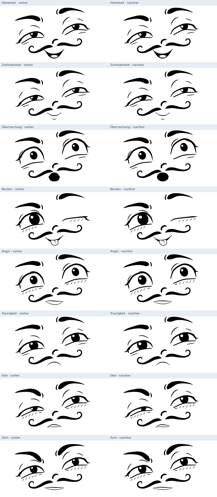

# Subtile Verfeinerung der Emotionsrezepte 1.1

Die bestehende Figur bleibt die Basis. Die neue Version macht die Kurven weicher und den Blick etwas wärmer, während Wut, Furcht und Traurigkeit ihre charakteristischen Hinweise behalten. Das Ziel ist ein sympathischer, leicht komödiantischer Ausdruck mit emotionaler Verletzlichkeit. Diese Wirkung ist eine Gestaltungsentscheidung und visuelle Agentenbeobachtung, kein gemessener psychologischer Score.

## Tatsächliche Änderungen

- **Strichenden:** Die abgeleiteten Bandkonturen werden dichter abgetastet und mit glatten Kurven interpoliert. Ihre Endrichtungen passen nun tangential zu den runden Kappen. Die kleinen Anschlussknicke an Brauen, Nase, Lidern und Wangenbändern entfallen. Die semantischen Anker bleiben erhalten.
- **Runde Münder:** Die acht vorhandenen Mundanker liegen bei O-/Pucker-Formen auf einer ovalen Ausgangsform. Gemeinsame vertikale Eckentangenten verbinden Ober- und Unterkurve; die vorherigen seitlichen Spitzen sind gerundet. Andere Mundformen werden nur leicht gerundet.
- **Lichtreflexe:** Etwas größere, runde Reflexe werden mit ihrer gesamten Ausdehnung innerhalb der sichtbaren Öffnung platziert. Bei engen Lidern verkleinern sie sich kontrolliert; sie werden nicht mehr unnötig zu eckigen weißen Flecken abgeschnitten.
- **Zwinkern und Lidschluss:** Ein kurzer leichter Wimpernschwung ersetzt den gekreuzten Abschluss. Die Linie des geschlossenen Auges bleibt eindeutig derselben Landmark-Komponente zugeordnet.
- **Wärmerer Charakter:** Der neue Rezeptwert `warmth` verändert Pupillenproportionen, Reflexgröße und Brauenspannung in kleinem Umfang. Zusätzlich wurden einzelne Profile behutsam abgestimmt: Zorn hat etwas weniger starre Kontraktion und einen minimal asymmetrischen Mund; Furcht einen verletzlicheren Blick und einen weniger groben gespannten Mund; Traurigkeit etwas weichere Augen. Negative Mundbögen bleiben negativ, notwendige Augenöffnungen und Brauenneigungen bleiben erhalten.
- **Ruhigere Handles:** In neuen Emotionsposen werden extreme Tangentenskalen des gefitteten Basisgesichts zu 10 % Richtung 1 entspannt. Die Ausgangsproportionen und lokale Bandbreiten bleiben die Grundlage.

## Vorher / Nachher

Die linke Seite zeigt die tatsächlich gesicherten Rezept-1.0-SVGs, die rechte Seite den aktuellen gemeinsamen Renderer mit Rezept 1.1. Die Darstellungen wurden aus SVG rasterisiert; keine generativen Bildmodelle oder nachträglichen Verschönerungen wurden eingesetzt.



Detailvergleiche: [runder Mund](../output/refinement/comparisons/round_mouth_detail.png), [Zorn: Auge und Striche](../output/refinement/comparisons/anger_eye_detail.png), [Zwinkern](../output/refinement/comparisons/wink_detail.png).

Alle 40 Kategorien besitzen eigene Vergleichsbilder. Familienbögen: [Basisemotionen](../output/refinement/comparisons/family_basic.png), [positive](../output/refinement/comparisons/family_positive.png), [soziale](../output/refinement/comparisons/family_social.png), [kognitive](../output/refinement/comparisons/family_cognitive.png), [negative](../output/refinement/comparisons/family_negative.png), [körperliche](../output/refinement/comparisons/family_physical.png). Zusätzlich wurden 80 Variationen mit identischen Seeds vor und nach der Änderung erzeugt.

## Messungen und Prüfungen

Der maschinenlesbare [Vergleichsbericht](../output/refinement/report.json) enthält für alle 40 Archetypen die Punktänderungen, Kurvenanschlusswinkel und SVG-Hashes. Über alle 101 Anker und 40 Archetypen beträgt die mittlere Verschiebung **0,577 kanonische Pixel**. Einige gezielt geänderte Wimpern-/Mund-/Reflexanker bewegen sich stärker; unveränderte Identitätsanker und latente Punkte sind in diesem Mittel ebenfalls enthalten. Der Wert ist kein Maß für wahrgenommene Ähnlichkeit.

Der größte gemessene Richtungswechsel zwischen benachbarten Segmenten der gefüllten Bandkonturen sank von **80,47° auf weniger als 0,001°**. Gemessen werden die tangentialen Anschlüsse aller registrierten Bandkomponenten einschließlich latenter Details; Ober-/Untermund und Zungenumrisse haben zusätzlich eigene Geometrieprüfungen. Der Wert bewertet Anschlussknicke, nicht Emotionserkennung oder sämtliche möglichen Überlagerungen zwischen verschiedenen Strichen.

40 Archetypen, 320 Varianten und zwölf Sequenzen mit jeweils 32 Frames wurden neu gerendert. Die geometrische Prüfung aller 780 Paare bei 25/50/75 % besteht weiterhin. Alle definierten Formhinweise bleiben erhalten, unter anderem die weiten Angst-/Überraschungsaugen, der einseitige Mundwinkel bei Verachtung, die gesenkten Zornbrauen und der Lidschluss bei Necken/Schmerz. Die aktuelle Testsuite besteht aus **114 bestandenen Tests**; neue Regressionstests prüfen insbesondere Kappenanschlüsse, O-Mund-Tangenten, Stilinterpolation und alte Posen.

Die echten Kontaktbögen wurden visuell geprüft und die Mundrundung sowie Reflexlage nachgebessert. Eine unabhängige menschliche Erkennungs- oder Sympathiebewertung liegt weiterhin nicht vor. Die [Bewertungsgalerie](emotions.md#menschliche-bewertung-ohne-erfundene-genauigkeit) bleibt dafür verfügbar.

## Serialisierung und Kompatibilität

Die 101 Landmark-IDs und `topology_id=cartoon_face_v1` bleiben gleich. Neue Emotionsposen tragen `recipe.version=1.1` und den verbindlichen Zusatz:

```json
"geometry": {
  "version": "smooth_v1",
  "ribbon_smoothing": 1.0,
  "mouth_rounding": 1.0
}
```

Das Beispiel zeigt einen runden Mund. Je nach Pose steht `mouth_rounding` auf 0, 0.08, 0.28 oder 1; Zwischenwerte entstehen bei Interpolation. Fehlende `geometry`-Felder bedeuten das bisherige Verfahren. Alle **120 archivierten alten Posen** (40 Archetypen und 80 Varianten) ergeben weiterhin byteidentische SVGs. Neue und alte Stile können stufenlos interpoliert werden; neue Posen speichern sämtliche tatsächlich benötigten Werte.

Ein größerer Wert für `warmth` erzeugt keine neue Emotionsklasse und keine pauschale Lächel-Mischung. Der Wert ist Teil der prozeduralen Entstehung; beim Wiederladen wird der aufgelöste Geometriezustand verwendet. Einzelheiten stehen in [data_format.md](data_format.md) und [emotions.md](emotions.md).

## Reproduzieren

```bash
.venv/bin/face validate_emotions --variations 8 --frames 32 --seed 42
.venv/bin/python tools/review_emotion_refinement.py
.venv/bin/python -m pytest -q
```

Das Vergleichsskript benötigt die gesicherten Originale in `output/refinement/before/`. Es rendert die rechte Vergleichsseite neu aus den aktuellen Rezepten und prüft das exakte Wieder-Rendering der alten JSONs. Änderungen an veröffentlichten Rezepten müssen erneut versioniert werden; die unveränderlichen vollständigen Pose-Zustände bleiben unabhängig davon renderbar.
