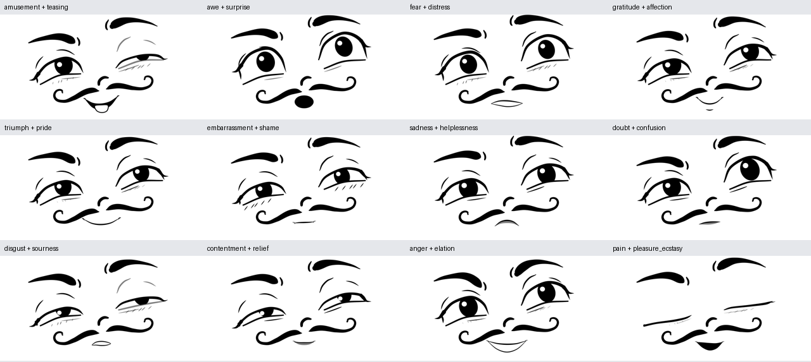

# 40 EmoNet-Face-Kategorien prozedural erzeugen

Die Emotionsschicht erzeugt vollständige Posen für das bestehende **101-Punkte-Rig**. Sie enthält einen Archetyp und einen korrelierten Variationsraum für jede der 40 Kategorien. Alle Ausgaben verwenden denselben SVG-Renderer wie Referenzrekonstruktion und Editor. Es gibt keine 40 separaten SVG-Vorlagen und keine neuen Landmark-IDs.

## Quelle und Aussagegrenze

Die Namen und Reihenfolge stammen aus der offiziellen Taxonomie zu [EmoNet-Face: An Expert-Annotated Benchmark for Synthetic Emotion Recognition](https://arxiv.org/abs/2505.20033) und dem [offiziellen Repository](https://github.com/LAION-AI/emonet-face). Verwendet wurde [guide.json am festgehaltenen Commit](https://raw.githubusercontent.com/LAION-AI/emonet-face/a788945dd78253a9a5ef8f36e72743c6d975d473/data/guide.json). Commit: `a788945dd78253a9a5ef8f36e72743c6d975d473`; SHA-256: `679049ed7ac1dc01ce28891132c8bc285032b84f2319f099fbd4aa2c23ec9191`. Die lokal gespeicherte Herkunft steht in [taxonomy_source.json](../src/cartoon_face/emotions/taxonomy_source.json).

Die Publikation liefert die Kategorien. **Unsere Cartoon-Mimikrezepte sind eigene Gestaltungsregeln**, keine aus dem Paper übernommenen universellen Gesichtsbewegungscodes. Freude, Angst oder Überraschung haben deutliche graphische Hinweise; Dankbarkeit, Stolz, Neid und ähnliche Zustände können ohne Situation oder Bewegung mehrdeutig bleiben. Ein beabsichtigtes Label ist deshalb noch kein menschlich bestätigtes Erkennungslabel. Die Bewertungsgalerie und ihre Auswertung erlauben, diese Lücke konkret zu messen.

Emotions-IDs laufen von **1 bis 40**; Landmark-IDs unabhängig davon von **0 bis 100**. `neutral` ist ein zusätzlicher Zustand außerhalb der 40 Kategorien und hat keinen Kategorieindex.

## Auf Knopfdruck

Alle Befehle aus dem Repository-Verzeichnis ausführen:

```bash
# Liste aller offiziellen Labels und stabilen Slugs
.venv/bin/face list_emotions

# Archetyp: kein Seed bedeutet genau die definierte Ausgangskonstellation
.venv/bin/face emotion --taxonomy emonet --name anger --output output/my_anger.svg

# Andere plausible Instanz derselben Kategorie; gleicher Seed wiederholt sie exakt
.venv/bin/face emotion --taxonomy emonet --name anger --seed 42 --variation 0.85 --output output/my_anger_42.svg

# Zurückhaltendere Emotionsintensität, geometrisch Richtung neutral interpoliert
.venv/bin/face emotion --taxonomy emonet --name sadness --intensity 0.7 --seed 7 --output output/my_sadness.svg

# 40 Archetypen plus 8 neue Variationen pro Kategorie: 360 SVG/PNG/JSON-Pakete
.venv/bin/face generate_emotions --variations 8 --seed 42

# Anteil von B: 0 = A, 1 = B. Ein Seed variiert beide Ausgangsrezepte.
.venv/bin/face mix --a gratitude --b affection --weight 0.4 --output output/warm_mix.svg

# Gespeicherte vollständige Posen statt erneuter Rezeptauswahl interpolieren
.venv/bin/face interpolate --from output/emonet/archetypes/01_amusement.json --to output/emonet/archetypes/18_teasing.json --frames 60 --output output/my_transition

# 360 Klassenbeispiele, alle 780 Paare numerisch und 12 gerenderte Sequenzen
.venv/bin/face validate_emotions --variations 8 --frames 32 --seed 42

# Lokaler Editor und Bewertungsgalerie
.venv/bin/face serve --port 8766
```

`emotion` und `mix` schreiben neben dem angegebenen SVG automatisch ein PNG und das **vollständige Pose-JSON**. Die alten 14 Ausdrücke bleiben über `--taxonomy legacy` verfügbar; dies ist der CLI-Standard für bestehende Skripte. EmoNet deshalb ausdrücklich mit `--taxonomy emonet` wählen.

Der Editor unter http://127.0.0.1:8766 kann alle 40 Archetypen laden, mit dem Seed neue Varianten erzeugen, zwei Kategorien mischen und anschließend die 101 Anker bzw. Rig-Werte weiter bearbeiten. Eine manuelle Änderung wird in `recipe.modified_after_generation` markiert; das Ziel-Label wird dadurch nicht nachträglich als erkannt bestätigt.

## Wie ein Rezept zu 101 Punkten wird

1. `catalog.json` definiert pro Kategorie eine kompakte Konstellation aus 24 Ausdruckskontrollen, diskreten Detailmodi und Variationsstärken.
2. `sample_actions` zieht sechs gemeinsame, begrenzte latente Zufallswerte. Öffnung, Aktivierung und Teile der Brauenbewegung hängen zusammen; Asymmetrien verschiedener Komponenten ebenfalls. Es werden keine 202 unabhängigen Landmark-Koordinaten gewürfelt.
3. `build_pose` übernimmt die Identitätsproportionen und Breiten des gefitteten Basisgesichts. Es berechnet daraus obere/untere Lider, Brauen, Pupillen, Reflexe, Mund, Wangenbewegung und optionale Details. Alle Berechnungen gehen in die bestehenden, semantisch benannten Anker und `rig`-Werte.
4. `refresh_states` berechnet die Sichtbarkeitszustände. Der gemeinsame Renderer leitet Bézier-Handles und gefüllte Bandkonturen aus diesem vollständigen Zustand ab.
5. Das resultierende JSON ist verbindlich. Beim Wiederladen werden Seed oder Rezept **nicht nochmals angewandt**. Deshalb lassen sich auch manuell bearbeitete Posen exakt wieder rendern.

Die Basis wird mit `poses/smile.json` geladen; die ursprüngliche freundliche Brauenneigung wird durch einen gemeinsamen neutralen Bogen ersetzt, bevor Angst, Zorn oder Trauer aufgebaut werden. Auge und Mund besitzen getrennte Kurvenkontrollen, statt nur vertikal skaliert zu werden. Blick und Lichtreflex folgen der tatsächlich sichtbaren Augenöffnung. Die Hauptbrauen, Lider und Wangenbänder bleiben vorhanden.

## Ausdruckskontrollen und Einheiten

Diese Kontrollen sind **Rezeptwerte**, keine zusätzlichen Landmark-IDs. Sie werden einmal in kanonische Geometrie umgesetzt. Als Faustregel sind Werte um 0 neutral, um 1 deutlich; `eye_open`, `pupil_scale`, `mouth_width` sind Verhältnisse. Die Formeln in [emotion_library.py](../src/cartoon_face/emotion_library.py) sind die verbindliche Definition.

| Kontrolle | Wirkung |
|---|---|
| `brow_raise` | gemeinsame Brauenhöhe; positive Werte heben beide Brauen |
| `brow_inner`, `brow_outer` | unabhängige Anhebung des inneren bzw. äußeren Brauenbereichs |
| `brow_arch`, `brow_asym` | Wölbung des Bogens und gegensinnige Höhenabweichung |
| `frown` | Brauenkontraktion; zusammen mit innerer Anhebung Sorge, ohne sie zornige innere Absenkung |
| `eye_open`, `eye_asym` | Grundöffnung und Differenz Figur links minus Figur rechts |
| `squint` | Anhebung der Unterlidmitte |
| `lid_curve`, `lid_tilt` | zusätzliche lokale Oberlidwölbung und Neigung; geschlossene positive/negative Bögen unterscheiden sich |
| `gaze_x`, `gaze_y` | Blick im Bild: positive x nach rechts, positive y nach unten; kein anatomischer Links-Parameter |
| `pupil_scale` | gemeinsame Pupillengröße, angepasst an die aktuelle Öffnung |
| `mouth_width` | Verhältnis zur Basisbreite von 210 kanonischen Pixeln |
| `smile` | positiver Wert: Mundwinkel hoch, Mitte tiefer; negativer Wert: trauriger Bogen |
| `mouth_open` | Mundtiefe; zusätzlich abhängig von geschlossenem, dunklem, weißem, rundem oder gespitztem Mundmodus |
| `mouth_asym` | Unterschied der beiden Mundwinkel |
| `mouth_tension` | gegensinnige lokale Verzerrung der beiden Mundhälften |
| `mouth_y` | vertikale Mundverschiebung |
| `cheek_lift` | Wangenbänder beim Ausdruck etwas anheben |
| `nose_lift` | kleine Nasenlinie anheben, beispielsweise bei Ekel |
| `curl` | gemeinsame Variation der eingerollten Wangenenden |
| `warmth` | subtile Charakterweichheit in `[0,1]`: etwas rundere Pupillen, lebendigere Reflexe und leicht gelöste Brauenspannung; negative Mundbögen bleiben negativ |

Mundmodi: `closed`, `dark`, `teeth`, `round`, `pucker`. `teeth` bedeutet einen weiß ausgesparten angespannten Mundinnenraum; es zeichnet keine einzelnen Zahnsegmente. Zungenmodi: `none`, `inside`, `out`. Unteraugen- und Reflexmodi verwenden die vorhandenen Rig-Komponenten. Die Herzen sind weiße Pupillenreflexe, kein Austausch des Auges durch eine neue Topologie.

Rezeptversion **1.1** verfeinert die bestehende Identität subtil: tangentiale Strichkappen, glattere abgeleitete Bandgrenzen, ovale O-Münder und ein einzelner leichter Wimpernschwung beim Zwinkern. Angst und Wut behalten ihre kennzeichnenden Brauen, Öffnungen und Mundspannung. Die Weichheit entsteht vor allem im Blick und in kleinen Asymmetrien. Es wird kein pauschales Lächeln auf negative Emotionen gesetzt. Der zusätzliche Geometriezustand steht im vollständigen Pose-JSON; alte Rezept-1.0-Posen bleiben exakt renderbar. [Vorher/Nachher und Messungen](emotion_refinement.md).

## Reproduzierbare Variationen

`variation` liegt in `[0,1]`. Ohne Seed oder mit `variation=0` bleibt das Rezept beim Archetyp. Mit Seed nutzt die Implementierung NumPys `default_rng`, sechs Normalverteilungen, auf ±1.65 begrenzt und mit pro Kategorie festgelegten Stärken skaliert. Der Datensatz verwendet `sample_seed = seed + category_id * 100000 + sample_index`; dies steht pro Bild im Manifest und Pose-JSON.

Die Standardstärken sind Aktivierung 0.28, Asymmetrie 0.22, Blick 0.34, Mund 0.22 und Stil 0.055. Geschlossene Genuss-/Schmerzaugen, das Zwinkern und ein suchender kognitiver Blick haben eigene Begrenzungen. Die Aktivierung beeinflusst Lidöffnung/Brauen; derselbe laterale Wert beeinflusst Brauen-, Lid- und Mundasymmetrie. Pupillengröße und Wangenlocke teilen einen kleinen Stileinfluss.

Die Signatur wird zusätzlich geschützt: positive/negative Mundbögen bleiben im passenden Bereich; neutrale Mundlinien erhalten wenig zufällige Krümmung; Verachtung behält einen einseitigen Mundwinkel; Angst/Überraschung behalten weite Augen; notwendiges Zwinkern und beidseitiger Lidschluss bleiben erhalten. Geschlossene Münder werden nicht zufällig geöffnet. Das sind **eigene Formregeln**, keine Garantie, dass Betrachter alle 40 Kategorien eindeutig benennen.

## Alle 40 Archetypen und ihre beabsichtigten Hinweise

`medium`: ausgeprägte graphische Hinweise, Erkennung noch ungemessen. `contextual`: besonders auf Situation/Bewegung oder benachbarte Kategorien angewiesen. `stylized`: bewusst eingesetzte Cartoon-Konvention. Diese Einstufung ist eine Designnotiz, kein empirischer Konfidenzwert.

| ID | Offizielles Label / CLI-Slug | Beabsichtigte Cartoon-Mimik | Vergleich / Einordnung |
|---|---|---|---|
| 1 | Amusement<br>`amusement` | Lachende enge Augen, angehobene Wangen und ein offenes leicht schiefes Lachen. | `elation` / medium |
| 2 | Elation<br>`elation` | Wache weite Augen, hochgezogene Brauen und breites freudiges Grinsen. | `triumph` / medium |
| 3 | Pleasure/Ecstasy<br>`pleasure_ecstasy` | Geschlossene weich gewölbte Lider und entspanntes kleines offenes Lächeln. | `contentment` / contextual |
| 4 | Contentment<br>`contentment` | Ruhige halb geschlossene Augen und ein symmetrisches sanftes Lächeln. | `relief` / contextual |
| 5 | Thankfulness/Gratitude<br>`gratitude` | Weicher innerer Brauenanstieg, freundlicher Blick und zurückhaltendes warmes Lächeln. | `affection` / contextual |
| 6 | Affection<br>`affection` | Warmer großer Blick mit Wangenheben und breiterem liebevollem Lächeln. | `gratitude` / contextual |
| 7 | Infatuation<br>`infatuation` | Herzreflexe als bewusste Cartoon-Konvention, Errötungsschraffuren und offenes verträumtes Lächeln. | `affection` / stylized |
| 8 | Hope/Enthusiasm/Optimism<br>`hope` | Erwartungsvoller aufwärts gerichteter Blick, angehobene innere Brauen und ein optimistisches Lächeln. | `interest` / contextual |
| 9 | Triumph<br>`triumph` | Überzeichnetes Siegergrinsen, enge selbstsichere Augen und kraftvoll angehobene äußere Brauen. | `pride` / contextual |
| 10 | Pride<br>`pride` | Ruhiger selbstbewusster Blick und ein kontrolliertes leicht asymmetrisches Lächeln. | `triumph` / contextual |
| 11 | Interest<br>`interest` | Aufmerksame offene Augen und ein kleines empfängliches Lächeln. | `concentration` / contextual |
| 12 | Awe<br>`awe` | Weite weiche Augen mit aufwärts gerichtetem Blick und kleinem offenem O-Mund. | `surprise` / medium |
| 13 | Astonishment/Surprise<br>`surprise` | Plötzlich weit geöffnete Augen, hohe Brauen, kleine Pupillen und großer runder O-Mund. | `fear` / medium |
| 14 | Concentration<br>`concentration` | Leicht zusammengezogene Brauen, fixierter Blick und schmale gepresste Mundlinie. | `contemplation` / contextual |
| 15 | Contemplation<br>`contemplation` | Blick schräg nach oben, eine erhöhte Braue und ein kleiner nachdenklich gespitzter Mund. | `doubt` / contextual |
| 16 | Relief<br>`relief` | Entspannte sinkende Lider und kleiner weicher Ausatem-Mund. | `contentment` / contextual |
| 17 | Longing<br>`longing` | Weicher seitlicher Fernblick, erhöhte innere Brauen und zurückhaltend wehmütiger Mund. | `sadness` / contextual |
| 18 | Teasing<br>`teasing` | Ein geschlossenes zwinkerndes Auge, schiefes Grinsen und kurze herausgestreckte Zunge. | `amusement` / stylized |
| 19 | Impatience and Irritability<br>`impatience` | Gereizter Seitenblick, gesenkte innere Brauen und angespannte schiefe Mundlinie. | `anger` / contextual |
| 20 | Sexual Lust<br>`lust` | Schwere halb geschlossene Lider, direkter großer Blick und ein leicht geöffnetes flirtendes Lächeln. | `infatuation` / contextual |
| 21 | Doubt<br>`doubt` | Eine deutlich höhere Braue, ein zusammengekniffenes Auge und skeptisch verzogener Mund. | `confusion` / contextual |
| 22 | Fear<br>`fear` | Hochgezogene zusammengezogene Brauen, weit offene Augen und horizontal gespannter weißer Mund. | `surprise` / medium |
| 23 | Distress<br>`distress` | Besorgte zusammengezogene Brauen, unruhige Augen und offener abwärts verzogener Mund. | `helplessness` / contextual |
| 24 | Confusion<br>`confusion` | Ungleiche hohe Brauen, suchender offener Blick und ein schief geöffneter kleiner Mund. | `doubt` / contextual |
| 25 | Embarrassment<br>`embarrassment` | Seitlich ausweichender Blick, Errötungsschraffuren und ein unsicheres schiefes Lächeln. | `shame` / contextual |
| 26 | Shame<br>`shame` | Gesenkter enger Blick, angehobene innere Brauen und kleiner zurückgenommener trauriger Mund. | `embarrassment` / contextual |
| 27 | Disappointment<br>`disappointment` | Sinkende Lider und Brauen mit breiter flacher abwärts gewölbter Mundlinie. | `sadness` / contextual |
| 28 | Sadness<br>`sadness` | Starker innerer Brauenanstieg, weicher gesenkter Blick und deutlicher symmetrischer trauriger Mundbogen. | `disappointment` / medium |
| 29 | Bitterness<br>`bitterness` | Mischung aus gesenktem missmutigem Blick und einseitig angespanntem Mundwinkel. | `contempt` / contextual |
| 30 | Contempt<br>`contempt` | Halb geschlossener herablassender Blick und ein deutlich einseitig hochgezogener Mundwinkel. | `pride` / contextual |
| 31 | Disgust<br>`disgust` | Zusammengezogene Lider, angehobene Nasenlinie und asymmetrische abwärts gezogene weiße Mundöffnung. | `sourness` / medium |
| 32 | Anger<br>`anger` | Tief gesenkte innere Brauen, schräger harter Blick und breiter zusammengebissener weißer Mund. | `impatience` / medium |
| 33 | Malevolence/Malice<br>`malice` | Wütend geneigte Brauen und schmale Augen kombiniert mit bewusst überzeichnetem boshaftem Grinsen. | `anger` / stylized |
| 34 | Sourness<br>`sourness` | Ein stark zusammengekniffenes Auge, gekräuselte kleine Lippen und angehobene Nase. | `disgust` / stylized |
| 35 | Pain<br>`pain` | Fest zusammengepresste abwärts gebogene Lider, zusammengezogene Brauen und offene Schmerzgrimasse. | `fear` / medium |
| 36 | Helplessness<br>`helplessness` | Hochgezogene innere Brauen, gesenkter bittender Blick und kleiner offener trauriger Mund. | `distress` / contextual |
| 37 | Fatigue/Exhaustion<br>`fatigue` | Schwere sinkende Lider, flach entspannte Brauen und kleiner gähnender O-Mund. | `numbness` / medium |
| 38 | Emotional Numbness<br>`numbness` | Unbewegter gerader Blick, reduzierte Brauenwölbung und waagerechte neutrale Mundlinie. | `fatigue` / contextual |
| 39 | Intoxication/Altered States of Consciousness<br>`intoxication` | Ungleiche schwere Lider, lockere ungleiche Brauen und entspannt schief geöffneter Mund. | `confusion` / contextual |
| 40 | Jealousy & Envy<br>`envy` | Harter seitlicher Blick mit zusammengezogenen Brauen und gepresstem missgünstigem Mund. | `bitterness` / contextual |


Variationsbögen: [Basisemotionen](../output/emonet/variations/family_basic.png), [positive](../output/emonet/variations/family_positive.png), [soziale](../output/emonet/variations/family_social.png), [kognitive](../output/emonet/variations/family_cognitive.png), [negative](../output/emonet/variations/family_negative.png), [körperliche](../output/emonet/variations/family_physical.png). Pro Kategorie liegen außerdem alle acht Varianten und ein eigener Kontaktbogen vor.

## Mischung und zeitlicher Übergang

`mix(a,b,weight)` und die Frame-Interpolation mischen den **aufgelösten Vektorzustand**: 101 Koordinaten, lokale Breiten, Tangentenskalen, Ellipsen und Deckkräfte. IDs wechseln nicht. Optionale Zungen-, Unterlippen- und Mundunterkonturen werden weich nahe einer sinnvollen Endform ein-/ausgeblendet. Unterschiedliche Mundinnenraum-Modi wechseln bei vorübergehend ausgeblendeter Füllung. Hatching und durchgehende Unteraugenlinien verwenden ihre bestehenden Komponenten.

Im Zwischenzustand sind teilweise graue Details durch Deckkraft möglich. Hauptkomponenten behalten ihre Identität. Die Labels tragen die tatsächlichen Steueranteile, beispielsweise 60 % Dankbarkeit und 40 % Zuneigung; eine Mischung wird nicht automatisch als dritte reine Emotion umbenannt.

Es gibt drei dokumentierte Mischregeln: `recommended` für manuell sinnvoll gewählte Paare, `related` für dieselbe Designfamilie und `ambivalent` für andere Kombinationen. Auch ambivalente Kombinationen sind technisch möglich; Zorn + Hochgefühl muss keine eindeutig erkennbare reine Kategorie ergeben. Die Regel ist eine **Authoring-Entscheidung**, kein psychologischer Kompatibilitätsscore.

Empfohlene Paare:

- `amusement` ↔ `teasing`
- `elation` ↔ `triumph`
- `pleasure_ecstasy` ↔ `contentment`
- `contentment` ↔ `relief`
- `gratitude` ↔ `affection`
- `infatuation` ↔ `affection`
- `hope` ↔ `interest`
- `triumph` ↔ `pride`
- `awe` ↔ `surprise`
- `concentration` ↔ `contemplation`
- `doubt` ↔ `confusion`
- `fear` ↔ `distress`
- `distress` ↔ `helplessness`
- `embarrassment` ↔ `shame`
- `disappointment` ↔ `sadness`
- `sadness` ↔ `helplessness`
- `bitterness` ↔ `envy`
- `contempt` ↔ `malice`
- `disgust` ↔ `sourness`
- `anger` ↔ `impatience`
- `fatigue` ↔ `numbness`



## Gespeicherte Emotionsdaten

Die vollständige Geometrie ist in [data_format.md](data_format.md) erklärt. Zusätzlich enthalten neue Posen:

```json
{
  "emotion": {
    "taxonomy_id": "emonet_face_40_v1",
    "category_id": 32,
    "slug": "anger",
    "label": "Anger",
    "intensity": 1.0,
    "weights": "40 numerische Werte: Index 31 ist 1, die übrigen sind 0",
    "label_kind": "intended_procedural_target",
    "human_validated": false
  },
  "recipe": {
    "version": "1.1",
    "seed": 42,
    "variation": 0.85,
    "intensity": 1.0,
    "actions": "vollständige numerische Kontrollen",
    "latents": "die verwendeten korrelierten Zufallswerte",
    "options": "die festgelegten Detailmodi"
  }
}
```

Dies ist ein **erklärender Ausschnitt**, keine renderbare vollständige Pose: die echten Werte sind Arrays bzw. Objekte, keine erläuternden Strings. Ein vollständiges Beispiel liegt unter [32_anger.json](../output/emonet/archetypes/32_anger.json). Bei Mischungen ist `category_id=null`; `weights[40]` mischt die Anteile. Bei geringerer Intensität ist die Gewichtssumme kleiner als 1; der Rest bedeutet neutral, ohne eine zusätzliche 41. Kategorie einzuführen.

`weights` sind weder Erkennungswahrscheinlichkeiten noch EmoNet-Expertenratings. `human_validated=false` bleibt erhalten, bis tatsächlich eine separate Bewertung vorliegt. `recipe` erlaubt Nachvollziehbarkeit; der vollständige Zustand ermöglicht exaktes Wieder-Rendering unabhängig von späteren Rezeptänderungen.

## Was validiert wird

[emotion_validation.py](../src/cartoon_face/emotion_validation.py) prüft tatsächlich erzeugte Geometrie, gültige SVGs, stabile 101 IDs, Sichtbarkeit der Hauptkomponenten, Tintenanteil und messbare Ausdruckshinweise. Die Hinweise werden an exportierten Ankern gemessen, beispielsweise Augenöffnung, Mundkrümmung und einseitige Mundwinkelverschiebung. Alle 780 Paare werden bei 25/50/75 % numerisch geprüft; zwölf repräsentative Sequenzen werden vollständig als SVG/PNG/JSON gerendert. Das ersetzt keine Wahrnehmungsbewertung aller 780 Paare.

Der Coding-Agent hat die realen Archetyp-, Variations- und Mischungsbilder betrachtet und die gemeinsame Brauenform, Pupillenmaskierung, Lichtreflexlage, gemischte Unteraugenlinien und Variationsstärken mehrfach korrigiert. Umfang, Prüfergebnisse und verbliebene Mehrdeutigkeiten stehen in [emotion_validation.md](emotion_validation.md); die vollständigen Zahlen in [manifest.json](../output/emonet/manifest.json) und [mixture_validation.json](../output/emonet/mixture_validation.json).

## Menschliche Bewertung ohne erfundene Genauigkeit

http://127.0.0.1:8766/emotions zeigt alle Archetypen bzw. erste Varianten. Zielnamen können ausgeblendet und die Karten zufällig angeordnet werden. Betrachter wählen aus 40 Kategorien oder `unclear`, geben Sicherheit 1–5 an und exportieren JSON. Pro Urteil wird gespeichert, ob der Zielname **zum Bewertungszeitpunkt** ausgeblendet war.

```bash
.venv/bin/face evaluate_reviews --input path/to/emotion_reviews.json --output output/emonet/review_results.json
```

Mehrere Dateien können nach `--input` angegeben werden. Die Auswertung schreibt JSON und eine 40×41-Konfusionsmatrix als CSV (40 erkannte Kategorien plus `unclear`). Sie berichtet Übereinstimmung mit dem beabsichtigten Ziel insgesamt und separat für Urteile mit ausgeblendeten Zielnamen. Noch nicht bewertete Kategorien bekommen `null`, keine ausgedachte Genauigkeit. Automatische UI-Testexporte werden ausdrücklich zurückgewiesen. Bisher liegen **keine menschlichen Erkennungsurteile** vor.

## Implementierung ändern

- [catalog.json](../src/cartoon_face/emotions/catalog.json): tatsächlich verwendete Rezepte und Herkunft.
- [create_emotion_catalog.py](../tools/create_emotion_catalog.py): nachvollziehbarer Autorensatz der 40 Rezepte; nach Änderungen ausführen.
- [emotion_library.py](../src/cartoon_face/emotion_library.py): korrelierte Variationen, Pose-Aufbau und Mischregeln.
- [animation.py](../src/cartoon_face/animation.py): gemeinsame kontinuierliche Geometrie und Detailübergänge.
- [emotion_reviews.py](../src/cartoon_face/emotion_reviews.py): Auswertung exportierter Bewertungen.
- `python tools/document_emotions.py`: diese aus dem Katalog abgeleitete Anleitung erneuern.

Rezeptänderungen, die vorhandene Seed-Ausgaben verändern, benötigen für veröffentlichte Datensätze eine neue Rezeptversion. Alte vollständige Pose-JSONs bleiben reproduzierbar. Für spätere Trainingsdaten sind intended labels und menschlich bestätigte Labels getrennt zu halten; diese Phase implementiert weiterhin keinen Detektor und kein Training.
