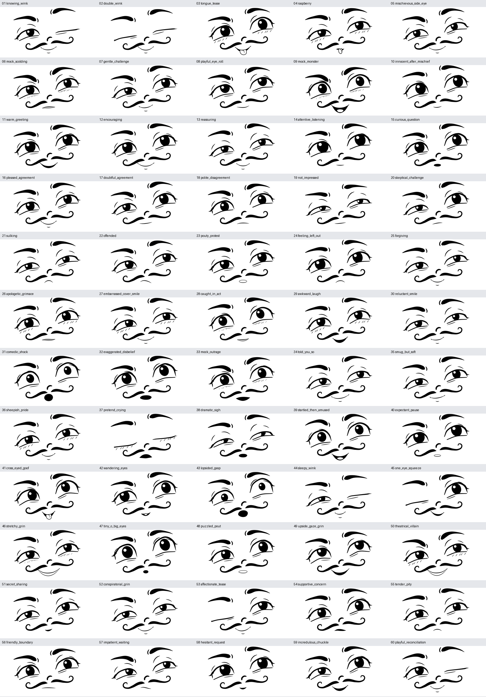

# 60 zusätzliche soziale und clowneske Ausdrücke

[Dokumentationsindex](README.md) · [Repository-Startseite](../README.md)

Der eigenständige Katalog `cartoon_social_60_v1` ergänzt die 40 veröffentlichten EmoNet-Kategorien. Seine IDs 1–60 gehören ausschließlich zum Feld `expression`. Alle Gesichter verwenden dieselben 101 Landmark-IDs und denselben SVG-Renderer. Die Szenarien sind gestalterische Ziele; feine soziale Bedeutungen benötigen oft Kontext und sind nicht durch menschliche Erkennungsstudien validiert.



## Reproduzierbare Generierung

```bash
.venv/bin/face list_social
.venv/bin/face social --name mock_monster --seed 42 --variation 0.85 --output output/monster.svg
.venv/bin/face generate_social --variations 4 --seed 42
```

Ohne Seed entsteht der Archetyp. Mit Seed werden korrelierte Ausdrucksparameter variiert. Geschlossene Augen, charakteristische Blickrichtungen und sichtbare Zunge sind dort, wo das Rezept sie verlangt, geschützt. Im großen Datensatz kommen zusammenhängende Formvariationen von Augen, Brauen, Mundbreite, Wangen und globaler Position hinzu; Pupillen und Reflexe folgen ihrem Auge.

## Vollständiger Katalog

| ID | Slug | Deutsches Gestaltungsziel | Familie | Sichtbarer Hinweis |
|---:|---|---|---|---|
| 1 | `knowing_wink` | Zwinkergruß | playful | Ein freundliches, wissendes Zwinkern als kurzer Gruß. |
| 2 | `double_wink` | Lachender Augenschluss | playful | Beide Augen lächelnd schließen: ein stilles herzliches Lachen. |
| 3 | `tongue_tease` | Frech die Zunge zeigen | playful | Beide Augen bleiben offen; kleine freche Zunge und schiefes Grinsen. |
| 4 | `raspberry` | Spielerisch prusten | playful | Schmaler gespitzter Mund mit Zunge: ein sanftes, albernes Prusten. |
| 5 | `mischievous_side_eye` | Neckischer Seitenblick | playful | Schalkhafter Seitenblick, ein etwas höherer Mundwinkel. |
| 6 | `mock_scolding` | Sanft spielerisch ausschimpfen | playful | Gespielte Strenge mit wachem weichem Blick und kleiner Mundasymmetrie. |
| 7 | `gentle_challenge` | Na, traust du dich? | playful | Eine fragende Braue und ein ermutigend herausforderndes Lächeln. |
| 8 | `playful_eye_roll` | Spielerisch die Augen verdrehen | playful | Augen nach oben, ein nachsichtiges schiefes Lächeln: ach, du wieder. |
| 9 | `mock_monster` | Buh, ich bin ein nettes Monster | playful | Großer gespielter Monster-Mund und überzeichnete Brauen, freundlicher Blick. |
| 10 | `innocent_after_mischief` | Ich war das ganz bestimmt nicht | playful | Unschuldiger großer Blick nach oben und ein winziges verräterisches Lächeln. |
| 11 | `warm_greeting` | Herzliche Begrüßung | welcoming | Offener direkter Blick und ein freudig geöffnetes Begrüßungslächeln. |
| 12 | `encouraging` | Du schaffst das | welcoming | Wacher direkter Blick und ein breites, zuversichtliches Lächeln. |
| 13 | `reassuring` | Alles wird gut | welcoming | Weiche innere Brauen und ein ruhiges beruhigendes Lächeln. |
| 14 | `attentive_listening` | Aufmerksam zuhören | welcoming | Wache Augen mit leichtem Seitenblick, kleiner ruhiger Mund. |
| 15 | `curious_question` | Ehrlich neugierig nachfragen | welcoming | Eine erhöhte Braue und ein kleines fragendes O. |
| 16 | `pleased_agreement` | Freudig zustimmen | welcoming | Ein klares freundliches Ja-Gesicht mit entspanntem Blick. |
| 17 | `doubtful_agreement` | Na gut, wenn du meinst | welcoming | Skeptische Braue, kleiner halber Smile und ein vorsichtiger Seitenblick. |
| 18 | `polite_disagreement` | Freundlich widersprechen | welcoming | Klarer direkter Blick und eine sanft gespannte schmale Mundlinie. |
| 19 | `not_impressed` | Charmant unbeeindruckt | welcoming | Schwere Lider und ein winziger schiefer Mundwinkel: aha, wirklich? |
| 20 | `skeptical_challenge` | Wirklich jetzt? | welcoming | Deutlich ungleiche Brauen, prüfender Blick und kleiner verzogener Mund. |
| 21 | `sulking` | Sanft eingeschnappt | hurt | Ausweichender Blick und kleines Schmollmäulchen, weich statt feindselig. |
| 22 | `offended` | Ein bisschen beleidigt | hurt | Verletzter Seitenblick und ein angespannt schiefer abwärts gezogener Mund. |
| 23 | `pouty_protest` | Schmollend protestieren | hurt | Große bittende Augen und überzeichnete kleine Schmoll-Lippen. |
| 24 | `feeling_left_out` | Ich möchte auch dabei sein | hurt | Bittender seitlicher Blick und zurückhaltender trauriger Mund. |
| 25 | `forgiving` | Schon gut, ich verzeihe dir | hurt | Nachsichtige enge Augen und ein gelöstes kleines Lächeln. |
| 26 | `apologetic_grimace` | Ups, das tut mir leid | hurt | Besorgte Brauen, ausweichender Blick und kleines verlegenes Zähnezeigen. |
| 27 | `embarrassed_cover_smile` | Peinlichkeit weglächeln | hurt | Ein zu großes schiefes Verlegenheitslächeln mit seitlichem Blick. |
| 28 | `caught_in_act` | Beim Schabernack erwischt | hurt | Große seitlich ausweichende Augen und ein kleines ertapptes Grinsen. |
| 29 | `awkward_laugh` | Unsicher mitlachen | hurt | Offenes asymmetrisches Lachen mit besorgten statt ausgelassenen Brauen. |
| 30 | `reluctant_smile` | Widerwillig doch lächeln | hurt | Ein einzelner steigender Mundwinkel trotz zurückhaltendem Blick. |
| 31 | `comedic_shock` | Komödiantisch erschrocken | theatrical | Weite ungleiche Augen und ein kleines schiefes Schreck-O. |
| 32 | `exaggerated_disbelief` | Das glaub ich jetzt nicht | theatrical | Überzeichnete hohe Braue und offener ungläubiger Mund. |
| 33 | `mock_outrage` | Gespielt empört | theatrical | Wache empörte Augen und eine offen gespielte Beschwerde. |
| 34 | `told_you_so` | Hab ich dir doch gesagt | theatrical | Verschmitzter Seitenblick und deutlich einseitiges Siegerlächeln. |
| 35 | `smug_but_soft` | Charmant selbstzufrieden | theatrical | Ein hochgezogener Mundwinkel mit weichem statt verächtlichem Blick. |
| 36 | `sheepish_pride` | Ein bisschen stolz, ein bisschen verlegen | theatrical | Bescheiden ausweichender Blick und ein kleines stolzes Grinsen. |
| 37 | `pretend_crying` | Theatralisch schmollen und heulen | theatrical | Geschlossene Trauerlider und überzeichnete weiche Heulgrimasse ohne Tränen-Sondertopologie. |
| 38 | `dramatic_sigh` | Ach, dieses Drama | theatrical | Schwere nachsichtige Lider und ein leicht schiefer Ausatem-Mund. |
| 39 | `startled_then_amused` | Erschrocken und schon am Lachen | theatrical | Weite Schreckaugen mit einem bereits entstehenden offenen Lachen. |
| 40 | `expectant_pause` | Na, was kommt jetzt? | theatrical | Abwartende hohe Braue und kleiner gespitzter Mund. |
| 41 | `cross_eyed_goof` | Albern schielen | goofy | Beide Pupillen einwärts, kleine Zunge und ausgelassenes Grinsen. |
| 42 | `wandering_eyes` | Alberner auseinanderlaufender Blick | goofy | Pupillen bewusst auseinander, freundliche verwirrte Mundöffnung. |
| 43 | `lopsided_gasp` | Schiefer Cartoon-Japs | goofy | Unterschiedlich große Augen und schiefes O als überzeichneter Japs. |
| 44 | `sleepy_wink` | Müde noch schnell zwinkern | goofy | Ein Auge geschlossen, das andere schläfrig und ein warmer kleiner Smile. |
| 45 | `one_eye_squeeze` | Ein Auge lustig zukneifen | goofy | Rechtes Auge zu, linkes wach; die Asymmetrie läuft bewusst andersherum. |
| 46 | `stretchy_grin` | Überbreit albern grinsen | goofy | Ein sehr breites weißes Grinsen mit weichen wachen Augen. |
| 47 | `tiny_o_big_eyes` | Riesenaugen, winziges Oh | goofy | Große glänzende Augen und ein bewusst winziger runder Mund. |
| 48 | `puzzled_pout` | Verwirrt die Lippen spitzen | goofy | Suchende ungleiche Augen und etwas überzeichnete Pucker-Lippen. |
| 49 | `upside_gaze_grin` | Augen hoch und frech grinsen | goofy | Aufwärts gerichtete Pupillen und ein offenes freches Grinsen. |
| 50 | `theatrical_villain` | Der freundliche Cartoon-Bösewicht | goofy | Gespielt böse Brauen, breites Grinsen und warme große Pupillen. |
| 51 | `secret_sharing` | Ein Geheimnis erzählen | subtle | Kleiner seitlicher Flüstermund und aufmerksamer Blick zur Seite. |
| 52 | `conspiratorial_grin` | Verschwörerisch grinsen | subtle | Enge freundliche Augen und ein verschwörerisches schiefes Lächeln. |
| 53 | `affectionate_tease` | Liebevoll necken | subtle | Großer warmer Blick, rechtes Zwinkern und liebevoll schiefer Smile. |
| 54 | `supportive_concern` | Besorgt, aber bei dir | subtle | Besorgte innere Brauen, direkter weicher Blick und zurückhaltender Mund. |
| 55 | `tender_pity` | Sanft mitfühlen | subtle | Ein weicher trauriger Blick ohne dramatische offene Grimasse. |
| 56 | `friendly_boundary` | Freundlich eine Grenze setzen | subtle | Wacher klarer Blick und ruhige feste Mundlinie, ohne aggressiven Zug. |
| 57 | `impatient_waiting` | Immer noch freundlich warten | subtle | Leicht gereizter Seitenblick und kleiner schiefer wartender Mund. |
| 58 | `hesitant_request` | Vorsichtig um etwas bitten | subtle | Bittende innere Brauen und kleiner vorsichtig geöffneter Mund. |
| 59 | `incredulous_chuckle` | Ungläubig schmunzeln | subtle | Eine skeptische Braue und ein warmes beginnendes Lachen. |
| 60 | `playful_reconciliation` | Versöhnlich wieder Scherze machen | subtle | Weicher versöhnlicher Blick und ein kleines verbindendes Zwinkern. |

## Datenformat und Mischungen

`expression.weights` enthält genau 60 Werte in katalogeigener Reihenfolge. Eine reine Kategorie hat einen One-hot-Vektor. `category_id` ist bei Mischungen null; `human_validated` bleibt false. `recipe` speichert Seed, tatsächlich aufgelöste Aktionen, gemeinsame Geometrieoptionen und geschützte Hinweise. Das vollständige `keypoints`/`rig`-Objekt ist die reproduzierbare Renderquelle.

Der Editor kann soziale Ausdrücke untereinander und mit den EmoNet-Emotionen mischen. Die beiden Zielvektoren bleiben getrennt: ein gemischtes Gesicht ist keine neue offizielle EmoNet-Kategorie. CLI-Interpolation funktioniert mit den exportierten Pose-JSONs. Optionale Zunge wird kontrolliert ein- und ausgeblendet. Für soziale Szenarien ist die geometrische Gültigkeit überprüfbar; die emotionale Bedeutung jeder Zwischenpose bleibt eine zu prüfende Gestaltungsannahme.

Siehe [Datenformat](data_format.md), [Unteraugen-Übergänge](under_eye.md) und [Datensatz und Augmentationen](dataset.md).
