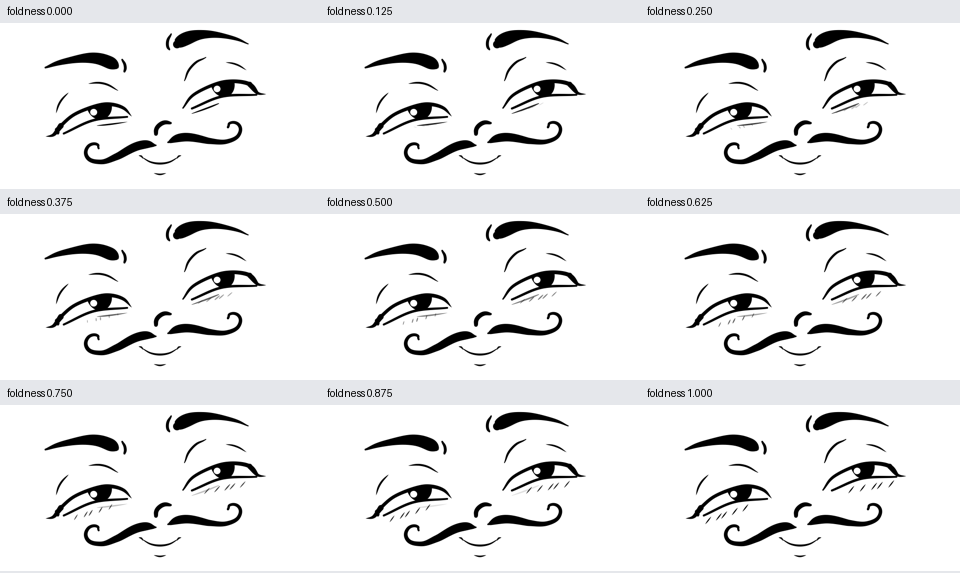

# Ein gemeinsamer Unteraugen-Übergang

[Dokumentationsindex](README.md) · [Repository-Startseite](../README.md)

Alle neu erzeugten EmoNet- und sozialen Posen verwenden `geometry.under_eye_transition = "stroke_bank_v1"`. Eine lange Unteraugenkurve und acht dauerhaft benannte interne Strichplätze bilden ein gemeinsames System. `rig.<side>_hatching.foldness` ist ein kontinuierlicher Wert von 0 bis 1: Die Striche liegen zunächst auf kleinen Abschnitten der Kurve und bewegen sich allmählich in kurze parallele Falten. Gleichzeitig wird die lange Kurve weich ausgeblendet. Es gibt keinen Austausch von Pfaden an der Mitte einer Interpolation.



Die fünf semantischen Landmark-IDs je Seite bleiben erhalten: drei Anker der Kurve sowie zwei Grenzen der Schraffurzone. Die acht Strichplätze sind abgeleitete SVG-Geometrie und bekommen keine zusätzlichen ML-IDs. Unsichtbare Punkte behalten ihre ursprüngliche Bedeutung und Position.

```python
from cartoon_face.emotion_library import emotion_pose40
from cartoon_face.under_eye import set_under_eye_blend
from cartoon_face.model import refresh_states
from cartoon_face.renderer import render_svg

pose = emotion_pose40("contentment")
set_under_eye_blend(pose, "left", 0.35)
set_under_eye_blend(pose, "right", 0.35)
refresh_states(pose)
svg = render_svg(pose)
```

`slot_weights` enthält acht Sichtbarkeitsgewichte. Die Position eines Strichplatzes hängt nicht mehr von der Anzahl gerade sichtbarer Striche ab. Deshalb verschieben sich beim Hinzukommen einer Falte die übrigen Falten nicht plötzlich. Der alte `count` bleibt für ältere Posen erhalten; im neuen System steuern die acht Slot-Gewichte die tatsächliche Belegung.

Die bisherigen Namen `none`, `continuous`, `mixed`, `hatching` sind Presets desselben Systems: unsichtbar, Phase 0, Phase 0,55 beziehungsweise Phase 1. Beim Morphen werden Phase, Slot-Gewichte, Breiten und beide Sichtbarkeiten interpoliert. `variants` ist dabei beschreibende Metainformation. Der Renderer schaltet die neue Geometrie nicht nach diesem String um. Der Editor hat je Seite einen zusätzlichen Regler „Kurve → Falten“.

Datensatz v2 speichert diese Geometrie explizit. Das Trainingscache wird ausschließlich daraus erstellt. Auch der MediaPipe-Mapper benutzt denselben Setter und glättet einen kontinuierlichen Unteraugenwert aus Lächeln und Zusammenkneifen. Die originalen gefitteten Referenzdateien behalten ihre historische Geometrie; der neue Modus ist gespeichert und optiert ältere Dateien nicht stillschweigend um.

Ein Test prüft 61 Phasen, alle permanenten Strich-IDs und unveränderte semantische Landmark-Koordinaten. Ältere und neue Posen behalten bei Interpolation an beiden Endpunkten ihre exakte SVG-Geometrie. Feine Zwischenlinien werden bewusst weich eingeblendet; dies ist keine anatomische Falten-Simulation.
