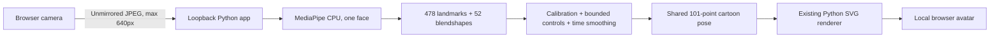

# Local webcam → soft cartoon SVG

[Full repository](https://github.com/christophschuhmann/cartoon-face-generator) · [Standalone ZIP download](https://github.com/christophschuhmann/cartoon-face-generator/releases/download/v1.0.0/cartoon_webcam_mapper.zip)

This README works for both the full repository and the standalone ZIP. In either case, run commands from the folder containing `webcam_mapper/`, `src/` and `poses/`. The ordinary face editor uses port **8766**; this webcam app uses **8765**.

This separate Python app maps a laptop camera to the project's existing cartoon avatar. It runs the official MediaPipe Face Landmarker on CPU, converts its 478 human landmarks and 52 blendshape scores into bounded semantic expression controls, then calls the same `cartoon_face.emotion_library.build_pose` and Python SVG renderer used by the editor. The avatar retains all 101 stable landmark IDs, its moustache, ink style and soft identity.

It does not train a human-face model, classify EmoNet's forty categories, infer a person's internal emotion, or replace the shared cartoon renderer.

## Run on a laptop

Use Python 3.11 or 3.12. CPython 3.12 on Linux was actually tested. Run from the repository root or the extracted `cartoon_webcam_mapper` folder:

```sh
python3.12 -m venv .venv
.venv/bin/python -m pip install -r webcam_mapper/requirements.txt
.venv/bin/python -m webcam_mapper.download_model
.venv/bin/python -m webcam_mapper.app --serve
```

Open **http://127.0.0.1:8765** on the same laptop, click **Start camera**, and grant the browser camera access. The app initially updates at 5 Hz; change the update selector or pass `--fps 10`. It slows down when CPU processing takes longer than the selected interval and allows only one frame request in flight. Choose **Calibrate neutral** while relaxed and looking forward; keep still for eight updates. **Reset calibration** clears the resting offsets. Save buttons download the current SVG and complete pose JSON.

On Windows, create the environment with `py -3.12 -m venv .venv` and replace `.venv/bin/python` with `.venv\Scripts\python.exe` in the commands. MediaPipe and the shared CairoSVG renderer need their native runtime dependencies. On Debian/Ubuntu, install `libcairo2`, `libglib2.0-0` and `libgl1` if missing; on macOS, `brew install cairo`. For Windows Cairo setup, follow the [CairoSVG installation instructions](https://cairosvg.org/documentation/). macOS and Windows webcam sessions were not available for testing here.

The downloadable ZIP can include the verified model for offline startup. Dependencies still need installation once. When the model is already bundled, the download command simply checks its pinned checksum. No account, access token or cloud service is needed.

## Dataflow and mapping

| File | Responsibility |
| --- | --- |
| [app.py](app.py) | local browser server, image and prerecorded video entry points |
| [landmarker.py](landmarker.py) | official MediaPipe CPU runtime, detection and timing |
| [mapping.py](mapping.py) | human signals, neutral calibration, smoothing and bounded cartoon controls |
| [download_model.py](download_model.py) | model acquisition and pinned checksum verification |
| [static/index.html](static/index.html) | camera controls and live SVG preview |
| [verify.py](verify.py), [browser_smoke.py](browser_smoke.py) | actual CPU/image/video and simulated browser-camera checks |
| [bundle.py](bundle.py) | allowlisted standalone ZIP with the shared renderer |
| [THIRD_PARTY.md](THIRD_PARTY.md) | external dependencies, model and test-photo provenance |



| Human signal | Authored avatar response |
| --- | --- |
| `eyeBlinkLeft/Right`, `eyeWide`, `eyeSquint` | Independent lid opening and wink, limited widening and squint |
| `browInnerUp`, `browOuterUpLeft/Right`, `browDown` | Brow raise, inner/outer curve and asymmetric contraction |
| `mouthSmileLeft/Right`, `mouthFrown` | Mouth curvature, asymmetry and mild cheek lift |
| `jawOpen` and normalized mesh lip gap | Bounded continuous mouth opening; lip gap preserves a teeth-parted smile even when jaw score is small |
| `mouthPucker`, `mouthFunnel`, `mouthStretch` | Narrowing/widening and a modest rounded-mouth cue |
| `eyeLookIn/Out/Up/Down` | Limited pupil displacement |
| `noseSneer` | Small nose lift |

The normalized mesh supplies aspect-correct eye-opening, lip-gap and iris ratios when relevant blendshape scores are absent. It also supplements `jawOpen` with actual lip separation. Mesh points never become traced cartoon contours. Subject-left/right names match the rig; only the camera preview is mirrored. Head rotation, face size and individual human anatomy do not alter the identity. Tongue and heart highlights stay disabled.

Neutral calibration uses the median of eight detected-face samples. A small score deadband suppresses rest noise. Expression smoothing defaults to a 0.12-second time constant, with faster eyelid response. Losing the face holds the last pose for 0.6 seconds, then decays toward neutral with a 0.35-second time constant. The shared `stroke_bank_v1` under-eye system is used across the app, editor and dataset. Its continuous blend follows smile and squint, from a mild 0.12 at rest to at most 0.60; the same temporal filter smooths this cue. No per-frame discrete decoration switch is performed.

## Images and prerecorded video

```sh
.venv/bin/python -m webcam_mapper.app --image /path/to/human_face.jpg --output avatar_result
.venv/bin/python -m webcam_mapper.app --video /path/to/local_video.mp4 --fps 5 --output avatar_frames
```

Image mode writes `avatar.svg`, `avatar.png`, `avatar.json` and `status.json`; exit code 2 means no face was found and the neutral fallback was rendered. Video mode writes sampled SVG/pose pairs and `video_report.json`. It preserves the input file and uses the video frame-rate timestamps. These modes intentionally write avatar artifacts when requested; the webcam browser mode stores no frames or recordings.

## Verification and packaging

```sh
.venv/bin/python -m pip install -r webcam_mapper/requirements-test.txt
.venv/bin/python -m pytest tests/test_webcam_mapper.py -q
.venv/bin/python -m webcam_mapper.verify
.venv/bin/python -m webcam_mapper.browser_smoke
.venv/bin/python -m webcam_mapper.bundle --include-model
```

In this repository the isolated MediaPipe environment is `webcam_mapper/.venv`; use its Python for actual CPU verification. The mapper's unit/API tests also run in the main environment without importing MediaPipe. The optional browser smoke check additionally needs FFmpeg and a Playwright Chromium install (`python -m playwright install chromium`); it uses a prerecorded fake camera. The allowlisted ZIP includes the exact shared renderer modules, topology/catalog data, `poses/smile.json`, the standalone app and the optional pinned model. It excludes datasets, training outputs, virtual environments, user media and credentials.

`webcam_mapper/output/verification/verification_report.json` records package versions, CPU model, repeated-image CPU timings, blank-frame detection, actual CPU API/calibration checks and a sampled synthetic video. It also contains a human-to-avatar comparison and nine authored cue renders for visual inspection. Timing excludes browser capture, transfer and display. No real laptop webcam was accessible in the build environment, and only one public-domain human subject was tested. These results establish pipeline functionality, not live webcam performance, broad robustness or emotion recognition accuracy.

## Local processing and practical limits

The app binds to `127.0.0.1`, uses no remote inference endpoint and has no telemetry. Browser frames are sent to the Python process on the same laptop, processed in memory and discarded. Camera access stops when **Stop** is clicked or the tab closes. Calibration stays in process memory and disappears at restart. Optional image/video modes save cartoon artifacts in the chosen output directory.

At 5 Hz, very short blinks can be missed. Occlusion, extreme head turns, poor light, glasses, unusual camera angles and small faces can degrade human landmark estimates. The retargeting is authored artwork with bounded cartoon exaggeration; it has not received human recognition review. MediaPipe startup may initialize an EGL graphics context on Linux, but this app explicitly requests the CPU delegate for inference. See [THIRD_PARTY.md](THIRD_PARTY.md) for source, model checksum and licensing details.
